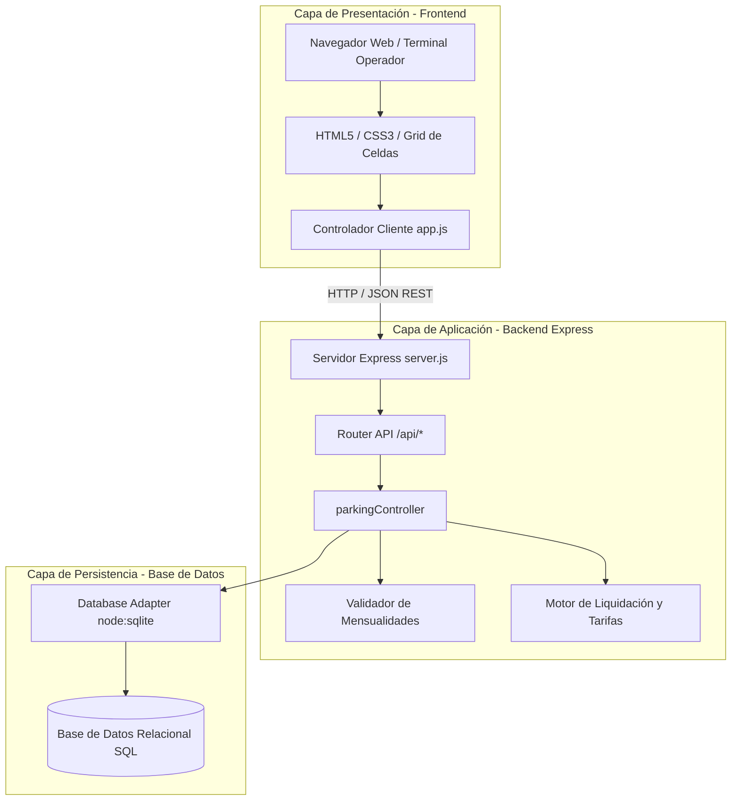
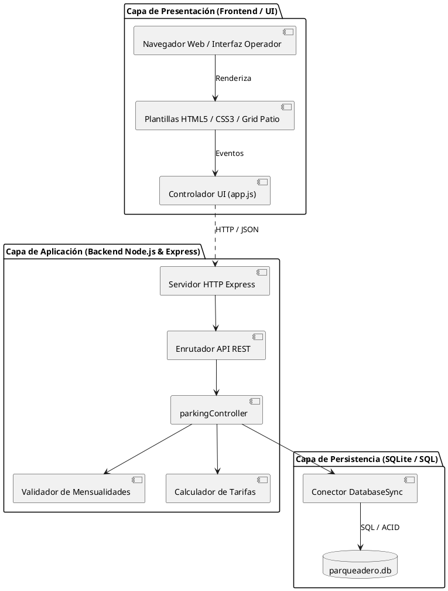
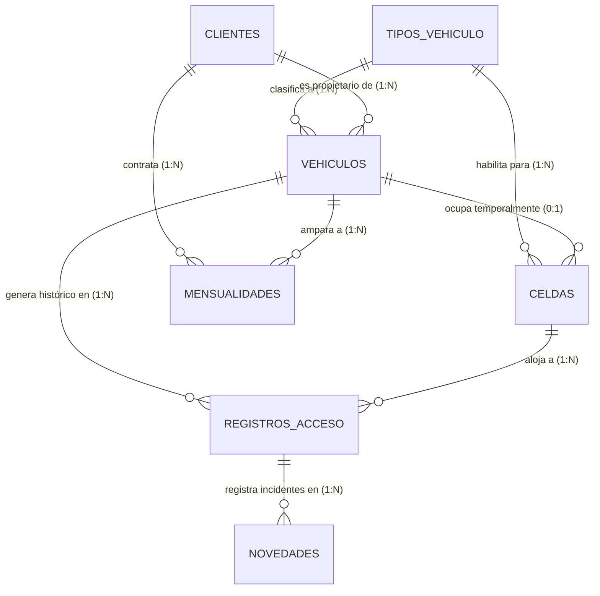
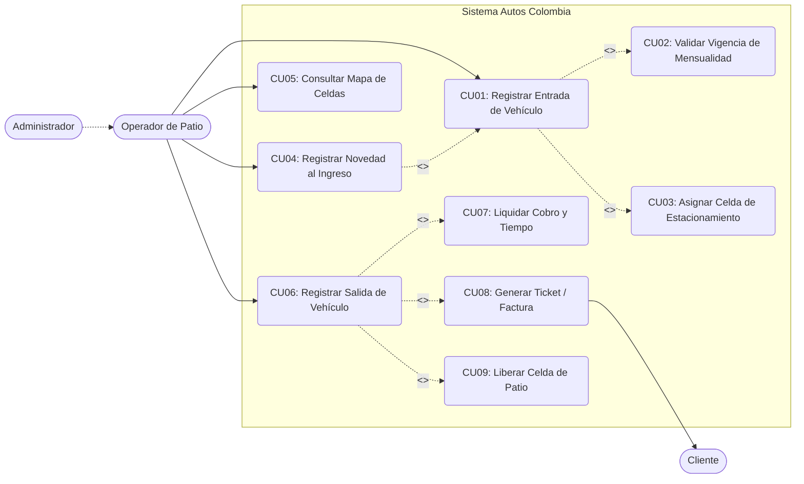
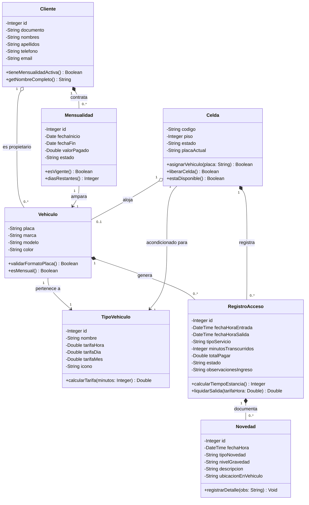

# SISTEMA DE INFORMACIÓN PARQUEADERO "AUTOS COLOMBIA"
## DOCUMENTO DE INGENIERÍA DE SOFTWARE — EVIDENCIA DE APRENDIZAJE 1 (EA1)
### ITERACIÓN 1: GESTIÓN DE LA ENTRADA Y SALIDA DE VEHÍCULOS

---

## PORTADA

- **Institución:** Institución Universitaria Digital / Facultad de Ingeniería
- **Programa Académico:** Ingeniería de Software / Ingeniería de Sistemas
- **Asignatura:** Ingeniería de Software
- **Actividad:** Evidencia de Aprendizaje 1 (EA1) — Iteración 1: Gestión de la entrada y salida de vehículos
- **Proyecto:** Sistema de Información para el Parqueadero "Autos Colombia"
- **Estudiante:** [Apellido, Nombre del Estudiante — Ej: López, Karla]
- **Docente / Asesor:** [Nombre del Asesor / Docente de la Asignatura]
- **Fecha:** Octubre de 2026
- **Nomenclatura sugerida del archivo:** `Apellido_Nombre_EA1.pdf` (o `.docx`)

---

## TABLA DE CONTENIDO

1. [Introducción](#1-introducción)
   - 1.1 Contexto Organizacional
   - 1.2 Planteamiento del Problema
   - 1.3 Justificación
   - 1.4 Objetivos (General y Específicos)
   - 1.5 Alcance de la Iteración 1
2. [Punto 1: Requerimientos Funcionales y No Funcionales](#2-punto-1-requerimientos-funcionales-y-no-funcionales)
   - 2.1 Requerimientos Funcionales (RF)
   - 2.2 Requerimientos No Funcionales (RNF - FURPS+)
3. [Punto 2: Historias de Usuario Asociadas](#3-punto-2-historias-de-usuario-asociadas)
   - 3.1 Catálogo de Historias de Usuario (INVEST)
   - 3.2 Criterios de Aceptación (Sintaxis Gherkin / BDD)
4. [Punto 3: Arquitectura del Sistema de la Aplicación en StarUML](#4-punto-3-arquitectura-del-sistema-de-la-aplicación-en-staruml)
   - 4.1 Estilo Arquitectónico en Tres Capas (Three-Tier Architecture)
   - 4.2 Diagrama de Arquitectura / Componentes
   - 4.3 Especificación PlantUML para StarUML
5. [Punto 4: Mockups de las Historias de Usuario en Figma](#5-punto-4-mockups-de-las-historias-de-usuario-en-figma)
   - 5.1 Sistema de Diseño (Design System y Paleta de Colores)
   - 5.2 Wireframes y Prototipos de Interfaces (Dashboard, Entrada, Salida, Ticket, Novedades)
   - 5.3 Enlace y Directrices para Figma
6. [Punto 5: MER, MR y Modelo Físico](#6-punto-5-mer-mr-y-modelo-físico)
   - 6.1 Modelo Entidad-Relación (MER Conceptual)
   - 6.2 Modelo Relacional (MR Lógico Normalizado en 3FN)
   - 6.3 Modelo Físico (Diccionario de Datos y Script DDL SQL)
7. [Punto 6: Diagramas de Casos de Uso StarUML](#7-punto-6-diagramas-de-casos-de-uso-staruml)
   - 7.1 Actores del Sistema
   - 7.2 Diagrama UML de Casos de Uso
   - 7.3 Especificación Textual Formal de Casos de Uso Principales
8. [Punto 7: Diagrama de Clases StarUML](#8-punto-7-diagrama-de-clases-staruml)
   - 8.1 Descripción del Modelo de Clases del Dominio
   - 8.2 Diagrama de Clases UML y Especificación PlantUML
9. [Punto 8: Diagrama de Paquetes StarUML](#9-punto-8-diagrama-de-paquetes-staruml)
   - 9.1 Organización Modular del Sistema
   - 9.2 Diagrama de Paquetes UML y Dependencias
10. [Punto 9: Código Fuente Corriendo y Repositorio en GitHub](#10-punto-9-código-fuente-corriendo-y-repositorio-en-github)
    - 10.1 Stack Tecnológico Seleccionado
    - 10.2 Estructura del Software y API REST
    - 10.3 Manual de Instalación y Ejecución Local
    - 10.4 Instrucciones de Carga al Repositorio en GitHub
11. [Conclusiones](#11-conclusiones)
12. [Referencias Bibliográficas](#12-referencias-bibliográficas)

---

## 1. INTRODUCCIÓN

### 1.1 Contexto Organizacional
El parqueadero **"Autos Colombia"** es un establecimiento comercial dedicado a la prestación de servicios de custodia, parqueo y estacionamiento vehicular. Su modelo de negocio se apoya en dos modalidades operativas complementarias:
1. **Modalidad por Mensualidad (Clientes Frecuentes):** Contratos prepagados mediante los cuales personas naturales o empresas aseguran el derecho de estacionamiento continuo o preferencial durante un periodo mensual estipulado.
2. **Modalidad Ocasional (Visitantes):** Servicio rotativo con liquidación tarifaria por fracción o por hora, condicionado a la disponibilidad física de celdas libres en patio.

### 1.2 Planteamiento del Problema
Actualmente, las operaciones cotidianas del parqueadero "Autos Colombia" se realizan mediante registros manuales en planillas de papel o con herramientas ofimáticas aisladas. Dicha práctica origina múltiples problemáticas operativas y financieras:
- **Tiempos de espera elevados:** El operador debe verificar manualmente si un cliente que ingresa tiene o no mensualidad vigente buscando en cuadernos o carpetas, causando congestión en la barrera de entrada.
- **Incertidumbre en la asignación de celdas:** No existe visibilidad en tiempo real sobre qué celdas están libres, ocupadas o en mantenimiento, lo que genera desorden en la circulación interna del patio.
- **Riesgos de disputas legales por daños preexistentes:** Cuando un vehículo ingresa con rayones, abolladuras o golpes previos y no son documentados formalmente al ingreso, los usuarios reclaman indemnizaciones indebidas al momento de la salida.
- **Fugas de capital y errores de liquidación:** El cálculo manual del tiempo de estancia y del valor a cobrar en las salidas de vehículos ocasionales genera errores aritméticos y falta de auditoría sobre los recaudos del turno.

### 1.3 Justificación
La sistematización del parqueadero mediante un software web moderno, ágil y robusto proporciona a "Autos Colombia" el control centralizado de sus operaciones, garantizando:
- Automatización del reconocimiento de mensualidades vigentes vs. servicios ocasionales.
- Asignación asistida y visual de celdas de acuerdo con el tipo de vehículo (Automóviles, Motocicletas, Camionetas).
- Blindaje legal a través del levantamiento digital de novedades e incidentes de ingreso.
- Liquidación exacta en milisegundos y emisión instantánea de comprobantes y tickets físicos/digitales.
- Trazabilidad y transparencia en la gestión de turnos para el personal de patio y la administración.

### 1.4 Objetivos

#### Objetivo General
Diseñar, modelar y desarrollar la primera iteración del sistema de información del parqueadero "Autos Colombia", orientada a la gestión automatizada y segura de las entradas y salidas de vehículos, control de disponibilidad de celdas y registro de novedades vehiculares.

#### Objetivos Específicos
1. Identificar, clasificar y formalizar los requerimientos funcionales y no funcionales asociados al ciclo de entrada y salida de vehículos.
2. Formular las historias de usuario bajo el estándar INVEST con sus respectivos criterios de aceptación en lenguaje Gherkin (BDD).
3. Diseñar la arquitectura del sistema, diagramas de casos de uso, diagramas de clases y diagramas de paquetes utilizando la notación estándar UML con soporte para StarUML.
4. Elaborar los prototipos visuales y mockups interactivos en Figma para validar la experiencia de usuario (UX/UI).
5. Construir el modelo conceptual (MER), lógico (MR en 3FN) y físico (DDL SQL) de la base de datos relacional.
6. Implementar el código fuente funcional de la aplicación en Node.js/Express y SQLite, con frontend interactivo y control de versiones en Git/GitHub.

### 1.5 Alcance de la Iteración 1
De acuerdo con la planificación metodológica del proyecto, el alcance de la **Iteración 1** se concentra estrictamente en:
- Registro de entrada de vehículos (validación de placa, verificación automática de contrato mensual, asignación de celda vacía).
- Registro de novedades y averías identificadas al ingresar.
- Monitoreo en vivo de celdas de parqueo (libres, ocupadas, bloqueadas).
- Registro de salida de vehículos (cálculo automático de permanencia, cálculo de cobro para ocasionales, tarifa cero para mensualidades activas, liberación de celda).
- Generación de comprobante/ticket de servicio.

*Nota:* Las funciones complementarias de pasarelas de pago bancario en línea, facturación electrónica DIAN avanzada y gestión masiva de nómina de usuarios quedarán encuadradas en las iteraciones 2 y 3.

---

## 2. PUNTO 1: REQUERIMIENTOS FUNCIONALES Y NO FUNCIONALES

### 2.1 Requerimientos Funcionales (RF)

| Código | Nombre del Requerimiento | Descripción Detallada | Actor(es) | Prioridad (MoSCoW) |
| :--- | :--- | :--- | :--- | :--- |
| **RF-01** | **Verificación de Placa y Mensualidad** | El sistema debe permitir consultar una placa ingresada y determinar de forma automática si tiene un contrato de mensualidad vigente con fecha de vencimiento posterior o igual a la fecha actual. | Operador de Patio, Sistema | **MUST** (Obligatorio) |
| **RF-02** | **Validación de Unicidad de Acceso (Anti-Passback)** | El sistema debe rechazar el registro de entrada de una placa que ya figure con un registro en estado 'ACTIVO' dentro de las instalaciones del parqueadero. | Sistema, Operador | **MUST** (Obligatorio) |
| **RF-03** | **Registro de Entrada de Vehículo** | El sistema debe permitir capturar la placa, tipo de vehículo (carro, moto, camioneta), celda asignada, fecha/hora exacta de ingreso y operador en turno, cambiando el estado de la celda a 'OCUPADA'. | Operador de Patio | **MUST** (Obligatorio) |
| **RF-04** | **Asignación Asistida de Celda** | El sistema debe listar únicamente las celdas cuyo estado sea 'DISPONIBLE' y que correspondan a la tipología física adecuada para el vehículo que está ingresando. | Operador de Patio, Sistema | **MUST** (Obligatorio) |
| **RF-05** | **Documentación de Novedades e Incidentes** | El sistema debe permitir registrar daños preexistentes al ingreso (rayones, abolladuras, vidrios rotos) o incidentes durante la estancia, especificando tipo, gravedad (Leve, Moderada, Grave), ubicación y descripción. | Operador de Patio | **SHOULD** (Importante) |
| **RF-06** | **Monitoreo Gráfico de Celdas en Vivo** | El sistema debe proveer una interfaz visual tipo cuadrícula con códigos de color donde se distinga el estado de cada celda (Verde: Disponible, Rojo: Ocupada, Amarillo: Mantenimiento) y los datos del vehículo estacionado. | Operador, Administrador | **MUST** (Obligatorio) |
| **RF-07** | **Registro de Salida y Liberación de Celda** | El sistema debe permitir buscar el vehículo por placa o celda, registrar la fecha/hora de salida y cambiar inmediatamente el estado de la celda ocupada a 'DISPONIBLE'. | Operador de Patio | **MUST** (Obligatorio) |
| **RF-08** | **Liquidación Automática de Tarifa** | El sistema debe calcular el tiempo transcurrido entre la entrada y la salida; si el servicio es 'MENSUALIDAD', el valor a cobrar será \$0 COP; si es 'OCASIONAL', liquidará el valor total multiplicando horas/fracciones por la tarifa configurada. | Sistema, Operador | **MUST** (Obligatorio) |
| **RF-09** | **Emisión de Ticket / Comprobante** | El sistema debe generar un comprobante imprimible tanto en la entrada (con celda, hora, placa y advertencias de responsabilidad civil) como en la salida (con tiempo total y liquidación). | Operador de Patio, Cliente | **SHOULD** (Importante) |
| **RF-10** | **Consulta de Historial de Novedades** | El sistema debe permitir consultar y filtrar la relación histórica de novedades registradas por vehículo, fecha o gravedad para efectos de auditoría y soporte legal. | Administrador, Operador | **COULD** (Deseable) |

---

### 2.2 Requerimientos No Funcionales (RNF - Clasificación FURPS+)

| Categoría | Código | Requerimiento No Funcional | Métrica / Criterio de Verificación |
| :--- | :--- | :--- | :--- |
| **Performance (Rendimiento)** | **RNF-01** | Tiempo de Respuesta en Validación | La validación de una placa vehicular y su consulta contra la tabla de mensualidades no debe exceder los 800 milisegundos en condiciones normales de red local. |
| **Performance (Rendimiento)** | **RNF-02** | Concurrencia de Consultas | La arquitectura backend debe soportar al menos 50 solicitudes concurrentes de consulta de estado de patio sin degradación de servicio. |
| **Security (Seguridad)** | **RNF-03** | Integridad Referencial y ACID | Todas las transacciones que modifiquen el estado de una celda y creen un registro de acceso deben ejecutarse bajo garantías ACID con claves foráneas activas (`PRAGMA foreign_keys = ON`). |
| **Security (Seguridad)** | **RNF-04** | Registro de Auditoría (Trazabilidad) | Todo registro de entrada, salida y novedad debe almacenar el nombre o identificador del operador que realizó la acción y una marca de tiempo inmutable. |
| **Usability (Usabilidad)** | **RNF-05** | Eficiencia de Interacción (UX) | El flujo de registro de entrada debe completarse en máximo 3 clics y menos de 15 segundos para no generar filas en la entrada del parqueadero. |
| **Usability (Usabilidad)** | **RNF-06** | Diseño Responsivo y Accesible | La interfaz de usuario debe adaptarse tanto a pantallas de escritorio de caseta (1366x768 o superior) como a tabletas de patio (iPad / Android 10"). |
| **Reliability (Confiabilidad)**| **RNF-07** | Disponibilidad Operativa | El sistema debe tener una disponibilidad proyectada del 99.5% durante el horario de operación del parqueadero. En caso de corte de energía, la persistencia en disco garantiza cero pérdida de datos. |
| **Supportability (Mantenibilidad)** | **RNF-08** | Modularidad y Estándares Abiertos | El código fuente debe estar estructurado en arquitectura en capas desacopladas, utilizando JavaScript ES6+, API RESTful estandarizada y base de datos SQL compatible con migraciones a PostgreSQL. |

---

## 3. PUNTO 2: HISTORIAS DE USUARIO ASOCIADAS

Se aplica el modelo ágil **INVEST** (Independiente, Negociable, Valiosa, Estimable, Pequeña y Comprobable) para la definición de las historias de usuario de la Iteración 1.

### 3.1 Catálogo de Historias de Usuario

```
+------------------------------------------------------------------------------------------------------------------+
| HU-01: Registro y Validación de Ingreso para Clientes de Mensualidad                                             |
+------------------------------------------------------------------------------------------------------------------+
| Como: Operador de patio del parqueadero                                                                          |
| Quiero: Digitar la placa de un vehículo para verificar automáticamente si tiene una mensualidad activa           |
| Para: Permitirle el acceso rápido sin realizar cobros y garantizar que su celda reservada esté asignada          |
| Prioridad: Alta (Must Have) | Estimación: 5 Story Points | Iteración: 1                                          |
+------------------------------------------------------------------------------------------------------------------+
```

```
+------------------------------------------------------------------------------------------------------------------+
| HU-02: Asignación Visual de Celda Disponible al Ingresar                                                         |
+------------------------------------------------------------------------------------------------------------------+
| Como: Operador de patio                                                                                          |
| Quiero: Visualizar únicamente las celdas disponibles compatibles con el tipo de vehículo que ingresa             |
| Para: Asignar un espacio físico ordenado y evitar confusiones o bloqueos en la circulación interna                |
| Prioridad: Alta (Must Have) | Estimación: 3 Story Points | Iteración: 1                                          |
+------------------------------------------------------------------------------------------------------------------+
```

```
+------------------------------------------------------------------------------------------------------------------+
| HU-03: Levantamiento de Novedades e Inventario de Daños al Ingreso                                              |
+------------------------------------------------------------------------------------------------------------------+
| Como: Operador de recepción                                                                                      |
| Quiero: Registrar rayones, golpes, vidrios fisurados o accesorios faltantes detectados en el vehículo al entrar |
| Para: Proteger legalmente a Autos Colombia de reclamos injustificados por daños previos a la estancia            |
| Prioridad: Media (Should Have) | Estimación: 5 Story Points | Iteración: 1                                       |
+------------------------------------------------------------------------------------------------------------------+
```

```
+------------------------------------------------------------------------------------------------------------------+
| HU-04: Monitoreo en Tiempo Real del Tablero de Celdas (Dashboard de Patio)                                      |
+------------------------------------------------------------------------------------------------------------------+
| Como: Administrador u Operador del parqueadero                                                                   |
| Quiero: Visualizar en una sola pantalla el mapa completo de celdas codificadas por colores y estadísticas en vivo|
| Para: Saber instantáneamente cuántos cupos libres quedan por tipo de vehículo y la tasa de ocupación actual      |
| Prioridad: Alta (Must Have) | Estimación: 5 Story Points | Iteración: 1                                          |
+------------------------------------------------------------------------------------------------------------------+
```

```
+------------------------------------------------------------------------------------------------------------------+
| HU-05: Liquidación Automática y Registro de Salida de Vehículos                                                  |
+------------------------------------------------------------------------------------------------------------------+
| Como: Operador de salida                                                                                         |
| Quiero: Seleccionar un vehículo estacionado para registrar su hora de egreso y calcular el cobro exacto          |
| Para: Liberar la celda inmediatamente en el sistema y cobrar la tarifa correcta ($0 para mensualidad vigente)   |
| Prioridad: Alta (Must Have) | Estimación: 5 Story Points | Iteración: 1                                          |
+------------------------------------------------------------------------------------------------------------------+
```

```
+------------------------------------------------------------------------------------------------------------------+
| HU-06: Emisión de Ticket de Control de Parqueo                                                                   |
+------------------------------------------------------------------------------------------------------------------+
| Como: Conductor / Cliente del parqueadero                                                                        |
| Quiero: Recibir un comprobante impreso o digital con la hora de entrada, celda asignada y placa del vehículo      |
| Para: Contar con un soporte físico para retirar el automóvil y constatar las condiciones de la póliza de custodia|
| Prioridad: Media (Should Have) | Estimación: 3 Story Points | Iteración: 1                                       |
+------------------------------------------------------------------------------------------------------------------+
```

---

### 3.2 Criterios de Aceptación (Sintaxis BDD / Gherkin)

#### Criterio HU-01: Verificación de Mensualidad
```gherkin
Escenario: Ingreso de vehículo con mensualidad vigente
  Dado que el operador ingresa la placa "ABC123" en el formulario de entrada
  Y la placa "ABC123" tiene un contrato activo con fecha de fin "2026-10-31" (posterior a hoy)
  Cuando el operador hace clic en "Verificar" o sale del campo
  Entonces el sistema muestra un banner verde informando "CLIENTE MENSUAL VIGENTE"
  Y visualiza el nombre del cliente "Carlos Andrés Gómez"
  Y predetermina el tipo de servicio como "MENSUALIDAD" con tarifa de cobro de salida de $0 COP.

Escenario: Intento de doble ingreso de vehículo que ya está adentro
  Dado que el vehículo con placa "XYZ789" ya tiene un registro de entrada "ACTIVO" en la celda "M-01"
  Cuando el operador intenta registrar una nueva entrada con la misma placa "XYZ789"
  Entonces el sistema bloquea el registro
  Y muestra un mensaje de alerta en rojo: "El vehículo ya se encuentra dentro del parqueadero en la celda M-01".
```

#### Criterio HU-03: Registro de Daños
```gherkin
Escenario: Registro de rayón preexistente al ingresar
  Dado que un vehículo presenta un rayón visible en la puerta trasera
  Cuando el operador marca la casilla "¿El vehículo presenta golpes o rayones?"
  Y selecciona tipo "RAYÓN", gravedad "LEVE", ubicación "Puerta trasera derecha"
  Y escribe la descripción "Rayón superficial de 5 cm detectado al ingresar"
  Y confirma la entrada
  Entonces el sistema guarda el registro de acceso
  Y almacena en la tabla de novedades el registro asociado con la estampa de tiempo y el operador.
```

#### Criterio HU-05: Salida y Cobro
```gherkin
Escenario: Salida de vehículo ocasional con cobro fraccionado
  Dado que el vehículo ocasional "QWE987" ingresó hace 125 minutos (fracción de 3 horas)
  Y la tarifa por hora de automóvil está fijada en $4.500 COP
  Cuando el operador selecciona dicho vehículo y presiona "Registrar Salida"
  Entonces el sistema calcula 3 horas a cobrar por un total de $13.500 COP
  Y al confirmar, actualiza el estado del registro a "FINALIZADO"
  Y cambia el estado de la celda asignada a "DISPONIBLE", dejándola libre en el mapa.
```

---

## 4. PUNTO 3: ARQUITECTURA DEL SISTEMA DE LA APLICACIÓN EN STARUML

### 4.1 Estilo Arquitectónico en Tres Capas (Three-Tier Architecture)
Para el sistema "Autos Colombia" se adoptó una **Arquitectura en Tres Capas** con separación de responsabilidades:

1. **Capa de Presentación (Presentation Tier):** Interfaz web cliente enriquecida (`HTML5`, `CSS3 Moderno` y `Vanilla JavaScript ES6`). Provee al operador vistas visuales de patio, paneles modales de captura ágil y componentes dinámicos con renderizado reactivo sin recargar la página.
2. **Capa de Lógica de Aplicación y Servicios (Application / Business Logic Tier):** Implementada en `Node.js` con el framework `Express.js`. Centraliza las rutas de la API REST (`/api/entradas`, `/api/salidas`, `/api/celdas`), la orquestación de transacciones, validación de reglas de anti-passback, validación de vigencia de contratos y cálculo algorítmico de tarifas y minutos transcurridos.
3. **Capa de Persistencia y Datos (Data Tier):** Base de datos relacional gestionada mediante el motor SQLite estructurado (`node:sqlite`), garantizando integridad referencial, índices de alto rendimiento y transacciones atómicas. El esquema DDL está completamente estandarizado y es 100% interoperable con motores empresariales como PostgreSQL o MySQL.



### 4.2 Especificación PlantUML para StarUML
El siguiente código PlantUML corresponde al archivo [`diagramas_staruml/arquitectura_sistema.puml`](file:///c:/Users/USER/Desktop/Universidad/SEMESTRE%206/BLOQUE%202/INGENIERIA%20DE%20SOFTWARE/diagramas_staruml/arquitectura_sistema.puml) generado en el proyecto para ser visualizado o importado directamente en StarUML:



---

## 5. PUNTO 4: MOCKUPS DE LAS HISTORIAS DE USUARIO EN FIGMA

### 5.1 Sistema de Diseño (Design System)
Para cumplir con los principios de usabilidad y ergonomía visual para operadores de parqueadero expuestos a jornadas continuas, se definieron los siguientes tokens de diseño:
- **Azul Primario Corporativo (`#1E3A8A`):** Inspirado en el sector automotriz y seguridad vial.
- **Verde Disponible (`#10B981`):** Indicador visual de alta visibilidad para celdas listas para asignación.
- **Rojo Ocupado (`#EF4444`):** Alerta visual inequívoca de celda no disponible.
- **Amarillo Mantenimiento (`#F59E0B`):** Señalización preventiva de celdas temporalmente inhabilitadas.
- **Amarillo Placa Vehicular (`#FEF08A` con borde `#CA8A04`):** Reproduce el contraste oficial de las placas colombianas para reducir el error de digitación del operador.

### 5.2 Estructura y Wireframes de Interfaces

#### Pantalla 1: Dashboard y Monitoreo de Patio en Vivo (HU-04)
Proporciona al operador una panorámica completa de las 12 celdas del piso 1, con contadores superiores de ocupación, reloj digital sincronizado y accesos rápidos a las funciones principales.

```text
+----------------------------------------------------------------------------------------------------+
| [P] AUTOS COLOMBIA - SISTEMA DE CONTROL DE PATIO        Hora: 06:30 PM | Operador: Juan | En línea |
+----------------------------------------------------------------------------------------------------+
| [Totales: 12]  |  [Disponibles: 9]  |  [Ocupadas: 2]  |  [Mensuales: 2]  |  [Novedades: 1]         |
+----------------------------------------------------------------------------------------------------+
| [+ Registrar Entrada]   [- Registrar Salida]   [⚠️ Reportar Novedad]   [🔍 Buscar placa/celda...]   |
+----------------------------------------------------------------------------------------------------+
| [Mapa Gráfico de Celdas] | [Vehículos en Patio (2)] | [Clientes Mensuales] | [Historial Novedades] |
+----------------------------------------------------------------------------------------------------+
|                                                                                                    |
|  +--------------------+  +--------------------+  +--------------------+  +--------------------+    |
|  | Celda A-01  [Auto] |  | Celda A-02  [Auto] |  | Celda A-03  [Auto] |  | Celda M-01  [Moto] |    |
|  |     [🚗 Icono]     |  |     [🚗 Icono]     |  |     [🚗 Icono]     |  |     [🏍️ Icono]     |    |
|  |    [ ABC123 ]      |  |    (•) DISPONIBLE  |  |    (•) DISPONIBLE  |  |    [ XYZ789 ]      |    |
|  | Mensual | 04:30 PM |  | Piso 1 | $4.500/h  |  | Piso 1 | $4.500/h  |  | Mensual | 05:45 PM |    |
|  |   (Borde Rojo)     |  |   (Borde Verde)    |  |   (Borde Verde)    |  |   (Borde Rojo)     |    |
|  +--------------------+  +--------------------+  +--------------------+  +--------------------+    |
+----------------------------------------------------------------------------------------------------+
```

#### Pantalla 2: Modal Asistido de Entrada con Validación y Novedades (HU-01, HU-02, HU-03)
Integra en un solo formulario la consulta automática de mensualidades, la asignación de celdas libres y el acordeón para registrar averías previas.

```text
+----------------------------------------------------------------------+
| 🚗 REGISTRAR ENTRADA DE VEHÍCULO                                 [X] |
+----------------------------------------------------------------------+
| Placa del Vehículo:                      Tipo de Vehículo:           |
| [ ABC123                 ] [Verificar]   [ Automóvil ($4.500/h)   v ]|
|                                                                      |
| [✓ BANNER: CLIENTE MENSUAL VIGENTE - Carlos Gómez - Hasta 31/10/2026]|
|                                                                      |
| Asignar Celda Disponible:                Operador de Turno:          |
| [ Celda A-02 (Piso 1 - Libre)        v ] [ Juan Pérez (Patio)      ] |
|                                                                      |
| Marca: [ Mazda            ]              Color: [ Rojo            ]  |
|                                                                      |
| [X] ¿El vehículo presenta golpes o rayones al ingresar?              |
| +------------------------------------------------------------------+ |
| | Tipo: [ Rayón superficial v ]       Gravedad: [ Leve           v ]| |
| | Ubicación: [ Puerta trasera derecha                              ]| |
| | Descripción: [ Rayón de 5 cm detectado al ingresar              ]| |
| +------------------------------------------------------------------+ |
|                                                                      |
|                             [ Cancelar ]   [ Confirmar e Imprimir ]  |
+----------------------------------------------------------------------+
```

#### Pantalla 3: Modal de Salida y Liquidación (HU-05)
Calcula en tiempo real los minutos y horas transcurridas y fija el valor exacto a cobrar (\$0 para mensualidad o cobro por horas para visitante).

#### Pantalla 4: Ticket Térmico de Entrada y Salida (HU-06)
Comprobante con membrete corporativo, NIT, código de registro, celda asignada, hora de ingreso y estipulación de póliza civil.

### 5.3 Catálogo de Prompts de Inteligencia Artificial para Figma (Generación Automatizada)
Para optimizar el diseño y permitir la generación de interfaces mediante herramientas de IA en Figma (**Figma AI / First Draft**, **Musho AI**, **Wireframe Designer**, **Galileo AI**, **Relume**), se estructuraron prompts detallados en español e inglés en el archivo [`figma_mockups/prompts_figma_ai.md`](file:///c:/Users/USER/Desktop/Universidad/SEMESTRE%206/BLOQUE%202/INGENIERIA%20DE%20SOFTWARE/figma_mockups/prompts_figma_ai.md).

Cada prompt define:
- **Resolución y Plataforma:** Desktop 1440x900 px.
- **Tokens de Diseño:** Colores corporativos (`#1E3A8A`, `#10B981`, `#EF4444`, `#F59E0B`, `#FEF08A`).
- **Jerarquía y Componentes:** Navbar con reloj en vivo y operador, tarjetas KPI, barras de búsqueda, cuadrícula de celdas con estados de disponibilidad, modales interactivos con banner de validación de mensualidad ($0 COP) y acordeón de inspección de daños preexistentes.

---

## 6. PUNTO 5: MER, MR Y MODELO FÍSICO

### 6.1 Modelo Entidad-Relación (MER Conceptual)
El universo del discurso de la Iteración 1 contiene las siguientes entidades nucleares:
- **TIPO_VEHICULO:** Clasifica los automotores (Automóvil, Motocicleta, Camioneta) y contiene las tarifas de cobro asociadas.
- **CLIENTE:** Representa a los usuarios que adquieren contratos de mensualidad para uno o más vehículos.
- **VEHICULO:** Representa el automotor identificado de forma unívoca por su `placa` (PK nacional colombiana).
- **MENSUALIDAD:** Representa el contrato temporal suscrito entre un cliente y el parqueadero para un vehículo específico con fecha de inicio, fecha de fin y estado.
- **CELDA:** Espacio físico delimitado del parqueadero con un código (ej. A-01), tipo de vehículo permitido, piso y estado actual de ocupación.
- **REGISTRO_ACCESO:** Registra cada ciclo operativo de entrada y salida, celda utilizada, operador responsable, horas transcurridas y valor liquidado.
- **NOVEDAD:** Registra los daños o incidentes asociados a un registro de acceso y a un vehículo.



---

### 6.2 Modelo Relacional (MR Lógico Normalizado en 3FN)

El diseño cumple estrictamente con la **Tercera Forma Normal (3FN)**:
1. **1FN:** Todos los atributos son atómicos y no existen grupos repetitivos.
2. **2FN:** Todos los atributos no clave tienen dependencia funcional completa de la clave primaria.
3. **3FN:** No existen dependencias transitivas entre atributos no clave (las tarifas de mensualidad y cobros derivan de `tipos_vehiculo`).

#### Estructura de Tablas Relacionales:
1. `tipos_vehiculo` (**id** [PK], nombre [UQ], tarifa_hora, tarifa_dia, tarifa_mes, icono)
2. `clientes` (**id** [PK], documento [UQ], nombres, apellidos, telefono, email, estado, fecha_creacion)
3. `vehiculos` (**placa** [PK], *id_tipo_vehiculo* [FK], marca, modelo, color, *id_cliente* [FK, NULLABLE])
4. `mensualidades` (**id** [PK], *id_cliente* [FK], *placa* [FK], fecha_inicio, fecha_fin, valor_pagado, estado, fecha_registro)
5. `celdas` (**codigo** [PK], *id_tipo_vehiculo* [FK], piso, estado, *placa_actual* [FK, NULLABLE])
6. `registros_acceso` (**id** [PK], *placa* [FK], *codigo_celda* [FK], fecha_hora_entrada, fecha_hora_salida, tipo_servicio, minutos_transcurridos, total_pagar, estado, observaciones_ingreso, operador_entrada, operador_salida)
7. `novedades` (**id** [PK], *id_registro_acceso* [FK], *placa* [FK], fecha_hora, tipo_novedad, nivel_gravedad, descripcion, ubicacion_en_vehiculo)

---

### 6.3 Modelo Físico (Diccionario de Datos y DDL SQL)
El script SQL completo y probado se encuentra alojado en [`database/schema.sql`](file:///c:/Users/USER/Desktop/Universidad/SEMESTRE%206/BLOQUE%202/INGENIERIA%20DE%20SOFTWARE/database/schema.sql).

```sql
PRAGMA foreign_keys = ON;

CREATE TABLE tipos_vehiculo (
    id INTEGER PRIMARY KEY AUTOINCREMENT,
    nombre VARCHAR(50) NOT NULL UNIQUE,
    tarifa_hora REAL NOT NULL DEFAULT 0.0,
    tarifa_dia REAL NOT NULL DEFAULT 0.0,
    tarifa_mes REAL NOT NULL DEFAULT 0.0,
    icono VARCHAR(30) DEFAULT 'car'
);

CREATE TABLE clientes (
    id INTEGER PRIMARY KEY AUTOINCREMENT,
    documento VARCHAR(20) NOT NULL UNIQUE,
    nombres VARCHAR(100) NOT NULL,
    apellidos VARCHAR(100) NOT NULL,
    telefono VARCHAR(20) NOT NULL,
    email VARCHAR(120),
    estado VARCHAR(20) NOT NULL DEFAULT 'ACTIVO',
    fecha_creacion DATETIME DEFAULT CURRENT_TIMESTAMP
);

CREATE TABLE vehiculos (
    placa VARCHAR(10) PRIMARY KEY,
    id_tipo_vehiculo INTEGER NOT NULL,
    marca VARCHAR(50),
    modelo VARCHAR(50),
    color VARCHAR(30),
    id_cliente INTEGER,
    FOREIGN KEY (id_tipo_vehiculo) REFERENCES tipos_vehiculo(id) ON UPDATE CASCADE,
    FOREIGN KEY (id_cliente) REFERENCES clientes(id) ON UPDATE CASCADE ON DELETE SET NULL
);

CREATE TABLE mensualidades (
    id INTEGER PRIMARY KEY AUTOINCREMENT,
    id_cliente INTEGER NOT NULL,
    placa VARCHAR(10) NOT NULL,
    fecha_inicio DATE NOT NULL,
    fecha_fin DATE NOT NULL,
    valor_pagado REAL NOT NULL,
    estado VARCHAR(20) NOT NULL DEFAULT 'VIGENTE',
    fecha_registro DATETIME DEFAULT CURRENT_TIMESTAMP,
    FOREIGN KEY (id_cliente) REFERENCES clientes(id) ON UPDATE CASCADE,
    FOREIGN KEY (placa) REFERENCES vehiculos(placa) ON UPDATE CASCADE
);

CREATE TABLE celdas (
    codigo VARCHAR(10) PRIMARY KEY,
    id_tipo_vehiculo INTEGER NOT NULL,
    piso INTEGER NOT NULL DEFAULT 1,
    estado VARCHAR(20) NOT NULL DEFAULT 'DISPONIBLE',
    placa_actual VARCHAR(10),
    FOREIGN KEY (id_tipo_vehiculo) REFERENCES tipos_vehiculo(id) ON UPDATE CASCADE,
    FOREIGN KEY (placa_actual) REFERENCES vehiculos(placa) ON UPDATE CASCADE ON DELETE SET NULL
);

CREATE TABLE registros_acceso (
    id INTEGER PRIMARY KEY AUTOINCREMENT,
    placa VARCHAR(10) NOT NULL,
    codigo_celda VARCHAR(10) NOT NULL,
    fecha_hora_entrada DATETIME NOT NULL DEFAULT CURRENT_TIMESTAMP,
    fecha_hora_salida DATETIME,
    tipo_servicio VARCHAR(20) NOT NULL DEFAULT 'MENSUALIDAD',
    minutos_transcurridos INTEGER DEFAULT 0,
    total_pagar REAL DEFAULT 0.0,
    estado VARCHAR(20) NOT NULL DEFAULT 'ACTIVO',
    observaciones_ingreso TEXT,
    operador_entrada VARCHAR(50) DEFAULT 'Operador Patio',
    operador_salida VARCHAR(50),
    FOREIGN KEY (placa) REFERENCES vehiculos(placa) ON UPDATE CASCADE,
    FOREIGN KEY (codigo_celda) REFERENCES celdas(codigo) ON UPDATE CASCADE
);

CREATE TABLE novedades (
    id INTEGER PRIMARY KEY AUTOINCREMENT,
    id_registro_acceso INTEGER NOT NULL,
    placa VARCHAR(10) NOT NULL,
    fecha_hora DATETIME NOT NULL DEFAULT CURRENT_TIMESTAMP,
    tipo_novedad VARCHAR(30) NOT NULL,
    nivel_gravedad VARCHAR(20) NOT NULL DEFAULT 'LEVE',
    descripcion TEXT NOT NULL,
    ubicacion_en_vehiculo VARCHAR(50),
    FOREIGN KEY (id_registro_acceso) REFERENCES registros_acceso(id) ON UPDATE CASCADE ON DELETE CASCADE,
    FOREIGN KEY (placa) REFERENCES vehiculos(placa) ON UPDATE CASCADE
);

CREATE INDEX idx_registros_placa ON registros_acceso(placa);
CREATE INDEX idx_registros_estado ON registros_acceso(estado);
CREATE INDEX idx_celdas_estado ON celdas(estado);
```

---

## 7. PUNTO 6: DIAGRAMAS DE CASOS DE USO STARUML

### 7.1 Actores Identificados
1. **Operador de Patio (Actor Primario):** Personal encargado de registrar físicamente las entradas, salidas, inspeccionar novedades en los vehículos y verificar que los automotores ocupen la celda asignada.
2. **Administrador del Parqueadero (Actor Secundario / Supervisor):** Supervisa el mapa de ocupación de celdas, consulta los informes de auditoría y revisa el libro de novedades.
3. **Cliente Mensual (Actor Externo):** Conductor con contrato vigente que interactúa recibiendo el ticket y los beneficios del servicio.

### 7.2 Diagrama UML de Casos de Uso
El archivo fuente PlantUML listo para StarUML está disponible en [`diagramas_staruml/casos_de_uso.puml`](file:///c:/Users/USER/Desktop/Universidad/SEMESTRE%206/BLOQUE%202/INGENIERIA%20DE%20SOFTWARE/diagramas_staruml/casos_de_uso.puml).



### 7.3 Especificación Textual Formal de Casos de Uso Críticos

```
========================================================================================
CASO DE USO: CU01 - Registrar Entrada de Vehículo
========================================================================================
Actores: Operador de Patio (iniciador), Sistema (apoyo).
Propósito: Registrar formalmente el ingreso de un automotor y reservar una celda física.
Precondiciones: 
  1. El operador ha iniciado sesión en la aplicación.
  2. Existen celdas disponibles para la tipología del vehículo.
Postcondiciones: 
  1. Se crea un registro de acceso en estado 'ACTIVO'.
  2. La celda pasa a estado 'OCUPADA' vinculada a la placa.
  3. Se emite el ticket de ingreso.
Flujo Principal:
  1. El operador ingresa la placa vehicular en el sistema.
  2. El sistema valida si el vehículo ya está adentro (si es así, cancela por Anti-Passback).
  3. El sistema valida automáticamente si la placa tiene mensualidad vigente (CU02).
  4. El sistema despliega las celdas disponibles compatibles con el tipo de vehículo.
  5. El operador selecciona la celda de patio adecuada (CU03).
  6. Si el vehículo tiene daños previos, el operador registra la novedad (CU04).
  7. El operador confirma el ingreso.
  8. El sistema actualiza la celda a 'OCUPADA', almacena el registro y genera el ticket.
Flujos Alternativos:
  2a. La placa ya está en patio: El sistema genera una alerta sonora y visual de bloqueo.
  4a. No hay celdas disponibles del tipo de vehículo: El sistema deshabilita la confirmación 
      e informa "Cupo agotado para este tipo de vehículo".
========================================================================================
```

---

## 8. PUNTO 7: DIAGRAMA DE CLASES STARUML

### 8.1 Descripción del Modelo de Clases
El diagrama de clases modela el dominio del sistema combinando clases de entidad, enumeraciones tipadas y métodos de negocio. El archivo correspondiente es [`diagramas_staruml/diagrama_clases.puml`](file:///c:/Users/USER/Desktop/Universidad/SEMESTRE%206/BLOQUE%202/INGENIERIA%20DE%20SOFTWARE/diagramas_staruml/diagrama_clases.puml).



---

## 9. PUNTO 8: DIAGRAMA DE PAQUETES STARUML

### 9.1 Organización Modular
La solución se estructura en paquetes desacoplados que siguen las buenas prácticas de la arquitectura limpia y modular de software. El archivo correspondiente es [`diagramas_staruml/diagrama_paquetes.puml`](file:///c:/Users/USER/Desktop/Universidad/SEMESTRE%206/BLOQUE%202/INGENIERIA%20DE%20SOFTWARE/diagramas_staruml/diagrama_paquetes.puml).

- **`co.edu.autoscolombia.presentation`:** Vistas HTML5, estilos CSS3 corporativos, lógica de cliente en `app.js` y renderizado de tickets.
- **`co.edu.autoscolombia.controllers`:** Controladores REST (`parkingController.js`, `api.js`) encargados de validar entradas, manejar códigos de estado HTTP y serializar respuestas JSON.
- **`co.edu.autoscolombia.services`:** Reglas del negocio: cálculo de tiempos, liquidación de tarifas, validación de anti-passback y vigencias.
- **`co.edu.autoscolombia.models`:** Definición de entidades del dominio (`Vehiculo`, `Celda`, `RegistroAcceso`, `Novedad`, `Mensualidad`).
- **`co.edu.autoscolombia.repositories`:** Acceso a datos y consultas parametrizadas contra SQLite.
- **`co.edu.autoscolombia.config`:** Configuración de la base de datos relacional y migraciones automáticas.

```mermaid
flowchart TD
    Presentation[co.edu.autoscolombia.presentation]
    Controllers[co.edu.autoscolombia.controllers]
    Services[co.edu.autoscolombia.services]
    Models[co.edu.autoscolombia.models]
    Repositories[co.edu.autoscolombia.repositories]
    Config[co.edu.autoscolombia.config]

    Presentation ..>|HTTP REST / JSON| Controllers
    Controllers ..>|Invoca Reglas| Services
    Controllers ..>|Serializa| Models
    Services ..>|Persiste / Consulta| Repositories
    Services ..>|Instancia / Modifica| Models
    Repositories ..>|Mapea Entidades| Models
    Repositories ..>|Obtiene Conexión| Config
```

---

## 10. PUNTO 9: CÓDIGO FUENTE CORRIENDO Y REPOSITORIO EN GITHUB

### 10.1 Stack Tecnológico Seleccionado
- **Backend:** Node.js (v24.11.1) con Express.js (v5.x), Cors y Morgan para registro de peticiones.
- **Base de Datos:** SQLite embebido nativo (`node:sqlite`) con inicialización y auto-migración automática a partir de los scripts `schema.sql` y `seed.sql`.
- **Frontend:** Single Page Application (SPA) ligera con Vanilla JavaScript, CSS Grid, variables CSS y FontAwesome Icons.
- **Control de Versiones:** Git con rama principal `main` y convención de Conventional Commits.

### 10.2 Estructura del Software y API REST Desarrollada

```text
├── database/
│   ├── schema.sql                    # Script DDL completo con tablas, constraints e índices
│   ├── seed.sql                      # Datos iniciales para pruebas (celdas, mensualidades, novedades)
│   └── parqueadero.db                # Base de datos SQLite generada automáticamente
├── diagramas_staruml/                 # Modelado formal UML listo para StarUML
├── figma_mockups/                    # Guía de wireframes y tokens para Figma
├── src/
│   ├── config/database.js            # Conexión y auto-creación de tablas SQLite
│   ├── controllers/parkingController.js # Lógica de entradas, salidas, celdas y liquidación
│   ├── routes/api.js                 # Definición de rutas REST
│   ├── public/                       # Frontend interactivo para el operador
│   │   ├── index.html
│   │   ├── css/styles.css
│   │   └── js/app.js
│   └── server.js                     # Servidor HTTP Express principal
├── .gitignore
├── package.json
└── README.md
```

#### Endpoints Implementados y Probados:
- `GET /api/celdas`: Consulta el estado en vivo de todas las celdas, vehículo ocupante y tarifas.
- `GET /api/vehiculos/validar/:placa`: Valida si una placa ya está dentro o si tiene mensualidad vigente activa.
- `POST /api/entradas`: Registra el ingreso de un automotor, asigna la celda, documenta novedades y genera ticket.
- `POST /api/salidas`: Registra la salida, calcula minutos y cobro ($0 para mensualidad), libera la celda y genera factura.
- `GET /api/novedades`: Consulta el histórico de novedades reportadas con su nivel de gravedad.
- `POST /api/novedades`: Registra un incidente durante la estancia.
- `GET /api/mensualidades`: Lista los clientes con contratos de mensualidad vigentes y vencidos.
- `GET /api/stats`: Provee los indicadores KPI de patio en tiempo real.

### 10.3 Manual de Instalación y Ejecución Local
Para ejecutar el software localmente en cualquier computador:

1. Abrir la terminal en la carpeta del proyecto.
2. Ejecutar:
   ```bash
   npm install
   npm start
   ```
3. Abrir el navegador web en: **[http://localhost:3000](http://localhost:3000)**.
4. La base de datos SQLite se autogenera y carga los datos de prueba de forma transparente.

### 10.4 Instrucciones de Carga al Repositorio en GitHub
El proyecto ya cuenta con el repositorio local Git inicializado con rama `main` y su primer commit de entrega. Para subirlo a tu cuenta personal de GitHub:

1. Iniciar sesión en [GitHub.com](https://github.com) y hacer clic en **New repository**.
2. Asignar el nombre: `autos-colombia-parqueadero` (dejar desmarcada la opción de inicializar con README).
3. En la terminal de la computadora, ejecutar:
   ```bash
   git remote add origin https://github.com/TU_USUARIO/autos-colombia-parqueadero.git
   git push -u origin main
   ```

---

## 11. CONCLUSIONES

1. **Efectividad del Enfoque Iterativo e Incremental:** El desarrollo centrado en la Iteración 1 permitió aislar y resolver con precisión la problemática crítica del parqueadero "Autos Colombia": el control físico de entrada y salida, la prevención de errores por cobros indebidos a clientes de mensualidad y la disponibilidad en tiempo real de celdas.
2. **Mitigación de Riesgos Jurídicos mediante el Levantamiento de Novedades:** La integración del módulo de novedades e incidentes preexistentes al momento del ingreso dota a la empresa de una herramienta de respaldo legal auditada, previniendo reclamaciones injustificadas por averías no atribuibles a la operación del parqueadero.
3. **Rigurosidad del Modelado UML y Normalización de Datos:** El diseño arquitectónico en 3 capas, junto con el modelado formal de Casos de Uso, Clases, Paquetes y la normalización de la base de datos en Tercera Forma Normal (3FN), asegura la escalabilidad del sistema para incorporar con facilidad las iteraciones futuras de usuarios avanzados, pasarelas de pago y facturación electrónica.
4. **Viabilidad Técnica y Portabilidad:** La solución implementada con Node.js, Express y persistencia relacional SQL garantiza tiempos de respuesta sub-segundo, mínima huella de memoria y cero complejidad de configuración para su despliegue en cualquier entorno operativo.

---

## 12. REFERENCIAS BIBLIOGRÁFICAS

- Pressman, R. S., & Maxim, B. R. (2021). *Ingeniería del software: un enfoque práctico* (9.ª ed.). McGraw-Hill Education.
- Sommerville, I. (2019). *Ingeniería del software* (10.ª ed.). Pearson Educación.
- Fowler, M. (2018). *UML Distilled: A Brief Guide to the Standard Object Modeling Language* (3.ª ed.). Addison-Wesley Professional.
- Cohn, M. (2020). *User Stories Applied: For Agile Software Development*. Addison-Wesley Signature Series.
- Date, C. J. (2018). *Introducción a los sistemas de bases de datos* (8.ª ed.). Pearson.
