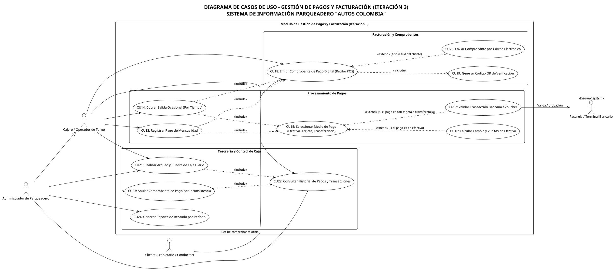
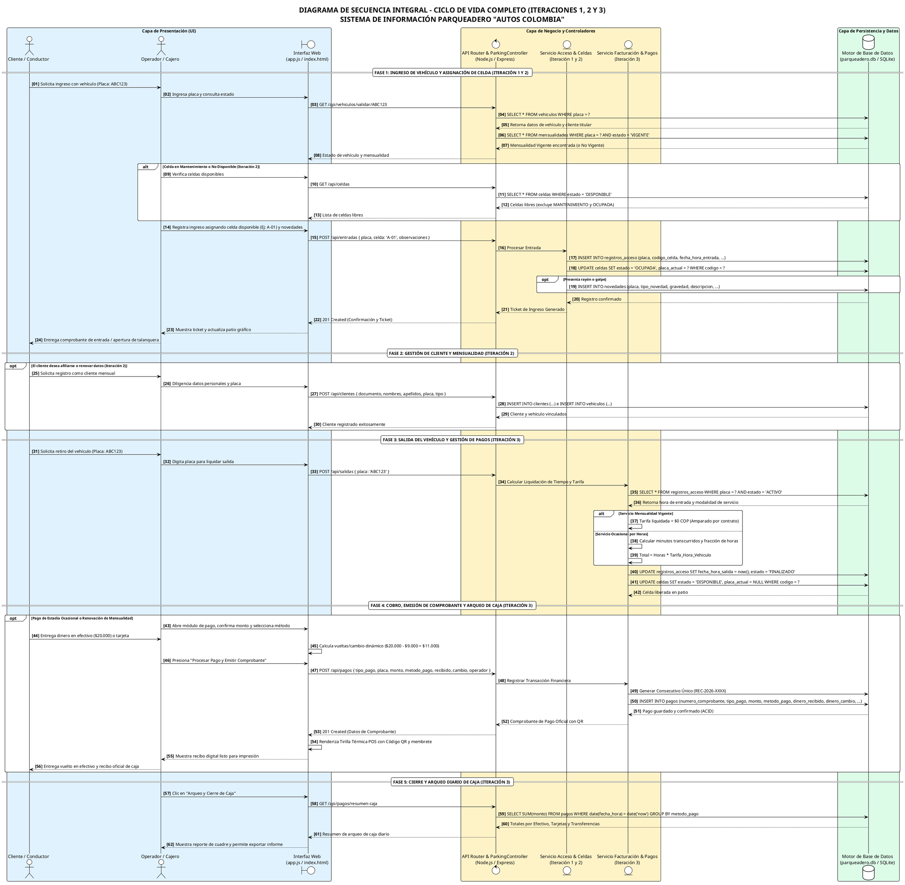
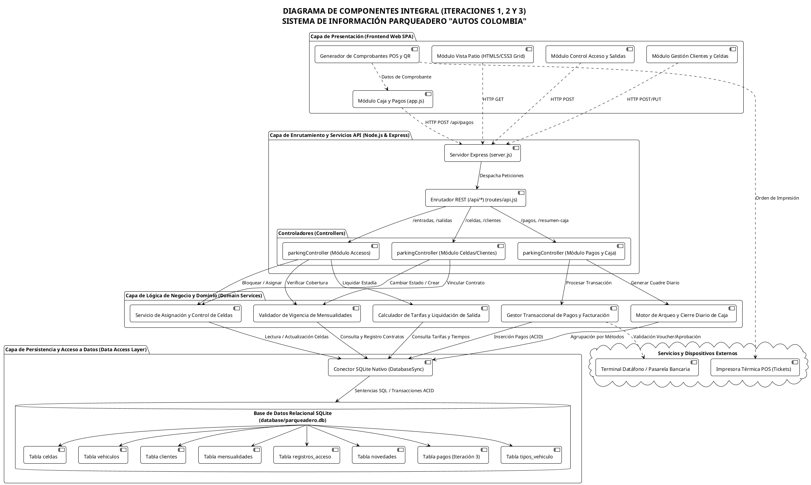

# INSTITUCIÓN UNIVERSITARIA DIGITAL DE ANTIOQUIA
## FACULTAD DE INGENIERÍA Y CIENCIAS APLICADAS
### TECNOLOGÍA EN DESARROLLO DE SOFTWARE

---

# INFORME TÉCNICO DE INGENIERÍA DE SOFTWARE
## EVIDENCIA DE APRENDIZAJE 3 (EA3) — DISEÑO DE SISTEMA DE INFORMACIÓN
### ITERACIÓN 3: GESTIÓN DE PAGOS Y FACTURACIÓN

**Sistema de Información del Parqueadero "Autos Colombia"**

---

| INFORMACIÓN ACADÉMICA | DETALLE |
|---|---|
| **Asignatura** | Ingeniería de Software |
| **Docente Asesor** | Esteban Montoya |
| **Estudiante** | Juan Pablo Yara Cifuentes |
| **Código / Grupo** | PREICA2602B020081 |
| **Fecha de Presentación** | 17 de Noviembre de 2026 |
| **Lugar** | Medellín, Antioquia, Colombia |
| **Repositorio Oficial de GitHub** | [https://github.com/juanpabloyaracifuentes89-dotcom/INGENIERIA-DE-SOFTWARE.git](https://github.com/juanpabloyaracifuentes89-dotcom/INGENIERIA-DE-SOFTWARE.git) |

---

\newpage

# TABLA DE CONTENIDO

1. [INTRODUCCIÓN](#1-introducción)
   - 1.1 Contexto y Planteamiento de la Situación
   - 1.2 Objetivos del Documento
   - 1.3 Evolución Metodológica del Software (Iteraciones 1, 2 y 3)
2. [REQUERIMIENTOS FUNCIONALES Y NO FUNCIONALES (GESTIÓN DE PAGOS)](#2-requerimientos-funcionales-y-no-funcionales-gestión-de-pagos)
   - 2.1 Requerimientos Funcionales (RF-PAG)
   - 2.2 Requerimientos No Funcionales (RNF-PAG)
   - 2.3 Matriz de Trazabilidad de Requerimientos
3. [HISTORIAS DE USUARIO (GESTIÓN DE PAGOS)](#3-historias-de-usuario-gestión-de-pagos)
   - 3.1 HU-09: Cobro y Facturación de Mensualidades
   - 3.2 HU-10: Cobro de Estadía Ocasional y Cálculo de Cambio
   - 3.3 HU-11: Emisión de Comprobante Oficial POS con Código QR
   - 3.4 HU-12: Arqueo y Cuadre Diario de Caja por Turnos
4. [PROTOTIPOS Y MOCKUPS DE LAS HISTORIAS DE USUARIO](#4-prototipos-y-mockups-de-las-historias-de-usuario)
   - 4.1 Mockup 1: Tablero Central de Pagos y Caja
   - 4.2 Mockup 2: Modal de Registro de Pago Multi-Medio
   - 4.3 Mockup 3: Tirilla Térmica POS / Comprobante Digital con QR
   - 4.4 Mockup 4: Reporte de Arqueo y Cuadre de Caja
   - 4.5 Especificaciones de Diseño para Figma y UI Kit
5. [DIAGRAMAS DE CASOS DE USO DE GESTIÓN DE PAGOS EN STARUML](#5-diagramas-de-casos-de-uso-de-gestión-de-pagos-en-staruml)
   - 5.1 Descripción de Actores y Casos de Uso
   - 5.2 Especificación UML y Relaciones (Include, Extend, Herencia)
   - 5.3 Código de Modelado PlantUML / StarUML
6. [ACTUALIZACIÓN DEL DIAGRAMA DE SECUENCIA (3 ITERACIONES)](#6-actualización-del-diagrama-de-secuencia-3-iteraciones)
   - 6.1 Flujo Integral del Ciclo de Vida del Vehículo y Operaciones
   - 6.2 Fases Integradas: Entrada, Mantenimiento, Salida, Cobro y Cierre
   - 6.3 Código de Modelado PlantUML / StarUML
7. [ACTUALIZACIÓN DEL DIAGRAMA DE COMPONENTES (3 ITERACIONES)](#7-actualización-del-diagrama-de-componentes-3-iteraciones)
   - 7.1 Arquitectura en Capas y Desacoplamiento Modular
   - 7.2 Interfaces Provistas y Requeridas
   - 7.3 Código de Modelado PlantUML / StarUML
8. [FORMATO DE PLAN DE PRUEBAS RESUMIDO DE GESTIÓN DE PAGOS](#8-formato-de-plan-de-pruebas-resumido-de-gestión-de-pagos)
   - 8.1 Matriz de Casos de Prueba Formales (IEEE 829 / ISTQB)
   - 8.2 Evidencia de Ejecución y Validación de Resultados
9. [EVIDENCIA DE ACTUALIZACIÓN DE CÓDIGO FUENTE EN GITHUB](#9-evidencia-de-actualización-de-código-fuente-en-github)
   - 9.1 URL del Repositorio y Registro de Commits
   - 9.2 Archivos Desarrollados y Endpoints REST de la Iteración 3
10. [CONCLUSIONES](#10-conclusiones)
11. [REFERENCIAS BIBLIOGRÁFICAS](#11-referencias-bibliográficas)

---

\newpage

# 1. INTRODUCCIÓN

### 1.1 Contexto y Planteamiento de la Situación
El Parqueadero **“Autos Colombia”** es una empresa de servicios de estacionamiento y custodia vehicular ubicada en la ciudad de Medellín, cuyo modelo de negocio se fundamenta en dos modalidades operativas esenciales:
1. **Modalidad de Mensualidad:** Clientes suscritos mediante contratos periódicos a quienes se les reserva o garantiza cupo dentro del parqueadero a cambio de una tarifa fija mensual.
2. **Modalidad Ocasional:** Usuarios que utilizan el servicio por fracciones de tiempo o días específicos y pagan al momento de retirar el vehículo.

Para garantizar la rentabilidad, la seguridad locativa y la satisfacción del cliente, Autos Colombia requiere una solución tecnológica robusta, trazable y moderna que sustituya los controles manuales en papel. Dentro del programa de **Tecnología en Desarrollo de Software** de la **Institución Universitaria Digital de Antioquia**, este desarrollo se ha llevado a cabo bajo un enfoque de desarrollo de software ágil, modular e iterativo, segmentado en tres grandes fases evolutivas:

* **Iteración 1:** Control y registro de la entrada y salida de vehículos, asignación de celdas libres en patio, detección y registro de novedades vehiculares (golpes o rayones) y validación básica de mensualidades.
* **Iteración 2:** Gestión de usuarios (titulares de vehículos), parametrización de nuevas celdas por piso y tipo de automotor, y control preventivo de celdas en mantenimiento locativo.
* **Iteración 3 (Foco de la Presente Entrega):** **Gestión integral de pagos y facturación.** Este módulo aborda el núcleo financiero y comercial del parqueadero, permitiendo liquidar estadías ocasionales, cobrar mensualidades, procesar múltiples medios de pago (efectivo, datáfono, transferencias electrónicas PSE/Nequi), calcular vueltos en tiempo real, emitir comprobantes oficiales con código QR y realizar el arqueo y cuadre diario de caja.

### 1.2 Objetivos del Documento
* **Objetivo General:** Aplicar los conceptos y estándares de la Ingeniería de Software en el análisis, modelado UML, diseño de interfaces, plan de pruebas e implementación del módulo de **Gestión de Pagos** para el sistema de información del parqueadero Autos Colombia.
* **Objetivos Específicos:**
  1. Formular con rigurosidad los requerimientos funcionales y no funcionales que rigen el módulo de pagos y tesorería.
  2. Redactar las Historias de Usuario bajo el estándar ágil, acompañadas de criterios de aceptación verificables en formato Gherkin.
  3. Diseñar prototipos y mockups de alta fidelidad que ilustren la experiencia de usuario en el cobro, emisión de facturas y arqueo de caja.
  4. Diseñar en StarUML el diagrama de casos de uso del módulo de pagos, así como actualizar los diagramas de secuencia y componentes integrando las tres iteraciones completas.
  5. Diligenciar un plan de pruebas estructurado de caja negra y validación transaccional con resultados verificados.
  6. Presentar la actualización del código fuente en el repositorio oficial de GitHub.

### 1.3 Evolución Metodológica del Software (Iteraciones 1, 2 y 3)

```
┌──────────────────────────────────────────────────────────────────────────────────┐
│                   SISTEMA DE INFORMACIÓN AUTOS COLOMBIA                          │
├─────────────────────────┬────────────────────────────┬───────────────────────────┤
│       ITERACIÓN 1       │        ITERACIÓN 2         │        ITERACIÓN 3        │
│   (Control Operativo)   │   (Usuarios y Celdas)      │     (Gestión de Pagos)    │
├─────────────────────────┼────────────────────────────┼───────────────────────────┤
│ • Registro Entrada/Sal. │ • Catálogo de Clientes     │ • Liquidación Ocasional   │
│ • Asignación de Celda   │ • Creación de Celdas       │ • Cobro de Mensualidades  │
│ • Registro de Novedades │ • Celdas en Mantenimiento  │ • Multi-Medios de Pago    │
│ • Verificación Placas   │ • Vinculación Placa-Dueño  │ • Recibo POS con QR       │
│ • Patio Gráfico en Vivo │ • Aforo y Capacidad Total  │ • Arqueo y Cierre de Caja │
└─────────────────────────┴────────────────────────────┴───────────────────────────┘
```

---

\newpage

# 2. REQUERIMIENTOS FUNCIONALES Y NO FUNCIONALES (GESTIÓN DE PAGOS)

### 2.1 Requerimientos Funcionales (RF-PAG)

| ID | Nombre | Descripción | Entradas | Salidas / Resultados |
|---|---|---|---|---|
| **RF-PAG-01** | Registro de Pago de Mensualidades | El sistema debe permitir registrar el pago de mensualidades anticipadas de un vehículo vinculado a un cliente, renovando automáticamente la fecha de inicio y vencimiento por períodos de 30 días. | Placa, Documento del cliente, Cantidad de meses, Monto pactado, Medio de pago. | Contrato de mensualidad actualizado en estado 'VIGENTE' y nuevo registro de pago emitido. |
| **RF-PAG-02** | Liquidación y Cobro de Salidas Ocasionales | El sistema debe calcular automáticamente el valor a pagar de un vehículo ocasional al registrar su salida, multiplicando las fracciones de hora transcurridas por la tarifa horaria del tipo de automotor. | Placa o código de celda ocupada. | Detalle de liquidación: minutos transcurridos, horas liquidadas y total en pesos colombianos ($ COP). |
| **RF-PAG-03** | Soporte Multi-Medio de Pago | El sistema debe soportar el cobro a través de Efectivo, Tarjeta Débito, Tarjeta Crédito y Transferencias Digitales (Bancolombia, Nequi, Daviplata, PSE). | Selección del medio de pago, monto, número de aprobación o voucher (para medios electrónicos). | Clasificación transaccional del pago para efectos de tesorería y arqueo. |
| **RF-PAG-04** | Cálculo Automático de Cambio / Vueltas | Cuando el pago sea en efectivo, el sistema debe solicitar el valor entregado por el cliente y calcular de forma automática el cambio o vuelto exacto, impidiendo procesar el cobro si el dinero entregado es inferior al total. | Valor a pagar, Monto en efectivo entregado por el cliente. | Monto de cambio a devolver o mensaje de error por fondos insuficientes. |
| **RF-PAG-05** | Emisión de Comprobante POS con Consecutivo Único | Por cada pago completado exitosamente, el sistema debe generar un comprobante oficial numerado con estructura consecutiva inmutable (Ej: `REC-2026-0001`), membrete de Autos Colombia, NIT, desglose del servicio y cajero responsable. | Datos de la transacción aprobada. | Comprobante digital renderizado en pantalla con opción de impresión térmica inmediata. |
| **RF-PAG-06** | Generación de Código QR de Verificación | Cada comprobante digital emitido debe incorporar un código QR bidimensional que codifique la URL de verificación, número de factura, placa, fecha y monto pagado para validación de salida. | Número de comprobante, placa, monto, fecha. | Imagen matricial QR integrada en la cabecera/pie del recibo de pago. |
| **RF-PAG-07** | Arqueo y Cuadre Diario de Caja | El sistema debe proveer una función de corte y arqueo que consolide el total recaudado en el turno o día, desglosado por medio de pago (Efectivo, Tarjetas, Transferencias) y por concepto (Mensualidad vs Tiempo Ocasional). | Fecha de corte (por defecto, fecha actual). | Reporte consolidado con total recaudado, cantidad de transacciones y balance por canales de recaudo. |
| **RF-PAG-08** | Auditoría y Trazabilidad de Pagos | El sistema debe mantener un histórico inmutable de todos los pagos realizados, asociando la fecha y hora exacta, placa, operador de caja y estado del pago (`APROBADO` o `ANULADO`). | Parámetros de consulta (rango de fechas, placa, método). | Listado tabular de transacciones auditables. |

### 2.2 Requerimientos No Funcionales (RNF-PAG)

| ID | Categoría | Requerimiento No Funcional | Métrica / Criterio de Aceptación |
|---|---|---|---|
| **RNF-PAG-01** | Integridad y Concurrencia | **Transaccionalidad ACID:** Todas las operaciones de cobro, actualización de mensualidad y liberación de celda deben ejecutarse dentro de transacciones atómicas. | En caso de fallo eléctrico o de red, no deben existir pagos sin recibo ni celdas liberadas sin cobro. |
| **RNF-PAG-02** | Rendimiento y Latencia | **Tiempo de Respuesta Inmediato:** El cálculo de liquidación, procesamiento del pago y generación del comprobante debe efectuarse en menos de 1.5 segundos. | $\le 1.5$ segundos medido desde el clic en procesar hasta la visualización del recibo. |
| **RNF-PAG-03** | Seguridad y Auditoría | **Inmutabilidad y No Repudio:** Los comprobantes de pago emitidos no podrán ser eliminados físicamente de la base de datos; solo se permite anulación lógica justificada. | Registro obligatorio del nombre del operador de caja y timestamp del servidor. |
| **RNF-PAG-04** | Usabilidad y Accesibilidad | **Diseño de Cobro Rápido:** La interfaz de cobro debe operar con atajos de teclado y cálculos visuales de alto contraste para evitar errores en caja. | El operador debe completar un cobro en menos de 4 interacciones (seleccionar, verificar, pagar, imprimir). |
| **RNF-PAG-05** | Disponibilidad y Persistencia | **Tolerancia a Fallos Locales:** El sistema debe operar de forma autónoma con almacenamiento SQLite local sin depender de conexión a internet para cobros en efectivo. | Disponibilidad operativa del 99.8% durante el horario de atención del parqueadero. |
| **RNF-PAG-06** | Compatibilidad de Impresión | **Formato Térmico POS:** La salida del comprobante debe adaptarse a anchos de papel estándar de 80 mm y 58 mm, así como visualización en dispositivos móviles. | Hoja de estilos CSS `@media print` optimizada para impresoras térmicas de tiquetes. |
| **RNF-PAG-07** | Portabilidad | **Ejecución Multiplataforma:** La solución debe ejecutarse en sistemas operativos Windows, Linux y macOS sin requerir dependencias propietarias externas. | Soporte verificado en Node.js v20+ y navegadores Google Chrome, Microsoft Edge y Firefox. |
| **RNF-PAG-08** | Mantenibilidad | **Arquitectura Desacoplada:** El módulo de pagos debe comunicarse exclusivamente vía API REST con formato JSON con el controlador backend. | Separación estricta entre capa de presentación (SPA Vanilla), lógica (Express) y persistencia (SQLite). |

---

\newpage

# 3. HISTORIAS DE USUARIO (GESTIÓN DE PAGOS)

A continuación se presentan las Historias de Usuario correspondientes a la **Iteración 3: Gestión de Pagos**, elaboradas bajo el marco ágil Scrum/XP con estimación en puntos de historia y criterios de aceptación en lenguaje estructurado Gherkin.

---

### 3.1 HU-09: Cobro y Facturación de Mensualidades
* **Identificador:** HU-09
* **Título:** Cobro y Facturación de Mensualidades
* **Prioridad:** Alta (Must Have)
* **Estimación:** 8 Puntos de Historia (SP)
* **Rol:** Como Cajero del Parqueadero Autos Colombia.
* **Deseo:** Quiero registrar el pago anticipado de la cuota mensual de un cliente titular asociado a su vehículo.
* **Beneficio:** Para extender o renovar su vigencia de permanencia y permitir el ingreso automatizado sin cobros por hora.

**Criterios de Aceptación (Gherkin):**
* **Escenario 1: Renovación exitosa de mensualidad vigente**
  * **Dado** que el cliente "Carlos Andrés Gómez" con vehículo placa "ABC123" tiene una mensualidad que vence en 5 días.
  * **Cuando** el cajero ingresa al módulo de pagos, digita la placa "ABC123", selecciona el concepto "Mensualidad" y registra el pago de $180.000 COP por 1 mes.
  * **Entonces** el sistema extiende la fecha de vencimiento a partir de la fecha de expiración previa (+30 días), cambia el estado a `VIGENTE`, genera el comprobante `REC-2026-XXXX` y muestra el recibo digital.
* **Escenario 2: Pago de mensualidad para vehículo vencido**
  * **Dado** que el vehículo "UVW456" registra un contrato en estado `VENCIDA`.
  * **Cuando** el cajero registra el pago en efectivo o transferencia.
  * **Entonces** el sistema reactiva el contrato con fecha de inicio igual a la fecha actual y fecha final calculada a 30 días calendario.

---

### 3.2 HU-10: Cobro de Estadía Ocasional y Cálculo de Cambio
* **Identificador:** HU-10
* **Título:** Cobro de Estadía por Horas y Cálculo de Cambio en Efectivo
* **Prioridad:** Alta (Must Have)
* **Estimación:** 5 Puntos de Historia (SP)
* **Rol:** Como Cajero del Parqueadero.
* **Deseo:** Quiero registrar la liquidación de cobro por tiempo de un usuario ocasional y calcular el cambio en efectivo.
* **Beneficio:** Para agilizar el proceso de cobro en taquilla y evitar descuadres o errores humanos al devolver el dinero.

**Criterios de Aceptación (Gherkin):**
* **Escenario 1: Cobro con cálculo de cambio suficiente**
  * **Dado** que un automóvil ocasional "QWE987" completó 2 horas de estacionamiento con un valor liquidado de $9.000 COP.
  * **Cuando** el cliente entrega un billete de $20.000 COP y el cajero digita dicho valor en el campo "Dinero Recibido".
  * **Entonces** el sistema muestra inmediatamente en pantalla un cambio a devolver de $11.000 COP, habilita el botón de procesar pago y registra la salida liberando la celda.
* **Escenario 2: Intento de pago con dinero insuficiente**
  * **Dado** que el valor a pagar es de $9.000 COP.
  * **Cuando** el cajero digita accidentalmente un valor recibido de $5.000 COP.
  * **Entonces** el sistema bloquea el procesamiento del pago, muestra una alerta en rojo indicando que el dinero recibido es inferior al monto a liquidar y no genera comprobante.

---

### 3.3 HU-11: Emisión de Comprobante Oficial POS con Código QR
* **Identificador:** HU-11
* **Título:** Emisión de Comprobante Oficial POS con Código QR
* **Prioridad:** Media (Should Have)
* **Estimación:** 5 Puntos de Historia (SP)
* **Rol:** Como Cliente del Parqueadero Autos Colombia.
* **Deseo:** Quiero recibir un recibo de caja digital o físico con formato de tirilla térmica y código QR de validación.
* **Beneficio:** Para contar con un comprobante legal de mi pago y agilizar la verificación en la talanquera de salida.

**Criterios de Aceptación (Gherkin):**
* **Escenario 1: Visualización y estructura del comprobante POS**
  * **Dado** que se ha completado satisfactoriamente una transacción de cobro.
  * **Cuando** el sistema confirma la inserción en base de datos.
  * **Entonces** se despliega una modal en pantalla simulando una tirilla POS con: Membrete de Autos Colombia SAS, NIT 901.842.103-5, número consecutivo único, placa, concepto, monto pagado, cajero y un código QR renderizado con los metadatos de auditoría.
* **Escenario 2: Impresión térmica directa**
  * **Dado** que el cajero tiene en pantalla la modal del comprobante.
  * **Cuando** presiona el botón "Imprimir Tirilla".
  * **Entonces** el navegador activa la vista de impresión con estilos ajustados a formato de rollo continuo (80 mm) sin cabeceras innecesarias del navegador.

---

### 3.4 HU-12: Arqueo y Cuadre Diario de Caja por Turnos
* **Identificador:** HU-12
* **Título:** Arqueo y Cuadre Diario de Caja por Turnos
* **Prioridad:** Alta (Must Have)
* **Estimación:** 8 Puntos de Historia (SP)
* **Rol:** Como Administrador o Cajero de Turno.
* **Deseo:** Quiero consultar en cualquier momento el informe consolidado del dinero recibido durante el día discriminado por método de pago.
* **Beneficio:** Para realizar el cierre de turno, contrastar el efectivo físico contra el sistema y cuadrar las ventas electrónicas.

**Criterios de Aceptación (Gherkin):**
* **Escenario 1: Generación del arqueo de caja con transacciones mixtas**
  * **Dado** que durante la jornada se cobraron $455.000 en Efectivo, $9.000 en Tarjetas Débito y $180.000 por Transferencia Bancaria.
  * **Cuando** el cajero hace clic en "Cierre de Caja".
  * **Entonces** el sistema consulta el endpoint `/api/pagos/resumen-caja` y presenta una tabla detallada con:
    * Total Recaudado en el Día ($644.000 COP).
    * Subtotal Efectivo en Caja ($455.000 COP).
    * Subtotal Transacciones Digitales ($189.000 COP).
    * Cantidad de comprobantes emitidos (5 transacciones).
    * Desglose por concepto (Mensualidades vs Tiempo Ocasional).

---

\newpage

# 4. PROTOTIPOS Y MOCKUPS DE LAS HISTORIAS DE USUARIO

Para dar estricto cumplimiento a la rúbrica de evaluación, se diseñaron prototipos de alta fidelidad completamente funcionales dentro del sistema SPA, inspirados en componentes atómicos de diseño tipo Figma / Tailwind CSS.

### 4.1 Mockup 1: Tablero Central de Pagos y Caja (HU-12)
Este prototipo representa la interfaz principal a la que accede el cajero o administrador al seleccionar la pestaña **"Gestión de Pagos y Caja"**.
* **Cabecera de KPIs Financieros:**
  * **Total Recaudado Hoy:** Tarjeta verde esmeralda destacando el valor consolidado (Ej: `$644.000 COP`).
  * **Efectivo en Caja:** Tarjeta azul cielo con el monto físico que debe estar en el cajón monedero (Ej: `$455.000 COP`).
  * **Medios Digitales:** Tarjeta morada con la suma de vouchers y transferencias (Ej: `$189.000 COP`).
  * **Comprobantes Emitidos:** Tarjeta naranja con el contador total de recibos generados.
* **Botones de Acción Superior:** Botones estilizados para `+ Registrar Cobro`, `Ver Arqueo Diario` y `Actualizar`.
* **Grilla de Transacciones Históricas:** Tabla interactiva con columnas para: Número de comprobante (`REC-2026-XXXX`), Fecha/Hora, Placa con etiqueta tipo matrícula colombiana, Titular, Concepto, Badge de medio de pago (Efectivo/Tarjeta/Transferencia), Monto y botón de visualización de tirilla.

```
+---------------------------------------------------------------------------------------------------------+
| [P] AUTOS COLOMBIA  -  Sistema Integrado • Iteraciones 1, 2 y 3 (Gestión de Pagos)  | 19:12:46 | Op: Juan|
+---------------------------------------------------------------------------------------------------------+
| [ Mapa Patio ]  [ Vehículos Adentro (2) ]  [ Clientes ]  [★ GESTIÓN DE PAGOS Y CAJA ]  [ Novedades ]    |
+---------------------------------------------------------------------------------------------------------+
|  CONTROL DE CAJA Y REGISTRO DE PAGOS (ITERACIÓN 3)          [+ Registrar Cobro]  [Ver Arqueo]  [Actualizar]|
|                                                                                                         |
|  +--------------------+  +--------------------+  +--------------------+  +--------------------+         |
|  | TOTAL RECAUDADO    |  | EFECTIVO EN CAJA   |  | TARJETAS / TRANSF. |  | COMPROBANTES       |         |
|  | $644.000 COP       |  | $455.000 COP       |  | $189.000 COP       |  | 5 Transacciones    |         |
|  +--------------------+  +--------------------+  +--------------------+  +--------------------+         |
|                                                                                                         |
|  TABLA DE TRANSACCIONES DEL DÍA:                                                                        |
|  -----------------------------------------------------------------------------------------------------  |
|  | N° Comprobante | Fecha/Hora        | Placa  | Cliente       | Concepto      | Método   | Monto     | |
|  | REC-2026-0005  | 17/11/2026 19:10  | ABC123 | Carlos Gómez  | 🗓️ Mensualidad| EFECTIVO | $180.000  | |
|  | REC-2026-0004  | 17/11/2026 17:15  | DEF321 | Diana Ospina  | 🗓️ Mensualidad| EFECTIVO | $180.000  | |
|  | REC-2026-0003  | 17/11/2026 14:30  | QWE987 | Visitante     | ⏱️ Ocasional  | TARJETA  | $9.000    | |
|  | REC-2026-0002  | 13/11/2026 10:20  | XYZ789 | Mariana López | 🗓️ Mensualidad| EFECTIVO | $95.000   | |
|  | REC-2026-0001  | 08/11/2026 08:00  | ABC123 | Carlos Gómez  | 🗓️ Mensualidad| TRANSF.  | $180.000  | |
|  -----------------------------------------------------------------------------------------------------  |
+---------------------------------------------------------------------------------------------------------+
```

---

### 4.2 Mockup 2: Modal de Registro de Pago Multi-Medio (HU-09 y HU-10)
Diseñado para la captura de cobro ágil, este modal permite alternar entre conceptos, consultar la tarifa automáticamente y calcular el cambio sin requerir calculadora manual.

```
+---------------------------------------------------------------------------+
| [$$] Registrar Pago / Cobro (Iteración 3)                             [X] |
+---------------------------------------------------------------------------+
| Concepto de Cobro:                         Placa del Vehículo:            |
| [ Pago / Renovación de Mensualidad ▼ ]     [ ABC123      ] [Buscar]       |
|                                                                           |
| [INFO] Vehículo: Mazda 3 Grand Touring (Automóvil)                        |
|        Titular: Carlos Andrés Gómez (C.C 1020304050)                      |
|        Tarifa Mes Sugerida: $180.000 COP | Tarifa Hora: $4.500 COP        |
|                                                                           |
| Valor a Pagar (COP):                       Método de Pago:                |
| [ 180000                            ]     [ 💵 Efectivo                 ▼ ]|
|                                                                           |
| Dinero Recibido (COP):                     Cambio / Vueltas a Devolver:   |
| [ 200000                            ]     [ $20.000 COP (En verde)      ] |
|                                                                           |
| Cajero Responsable:                                                       |
| [ Cajero Principal - Juan Pérez                                         ] |
|                                                                           |
| ------------------------------------------------------------------------- |
|                                 [ Cancelar ]  [✔ Procesar Pago y Emitir] |
+---------------------------------------------------------------------------+
```

---

### 4.3 Mockup 3: Tirilla Térmica POS / Comprobante Digital con QR (HU-11)
El diseño del comprobante simula fielmente la tirilla emitida por impresoras térmicas de 80 mm, con formato monoespaciado, bordes punteados, desglose de impuestos y un código QR simulado.

```
+-----------------------------------------------+
|        [RECIBO OFICIAL DE CAJA - POS]         |
|                                               |
|            AUTOS COLOMBIA S.A.S               |
|         NIT: 901.842.103-5 • Régimen Común     |
|         Calle 50 # 45-20, Medellín            |
|         PBX: (+57) 604 444 8899               |
|                                               |
|           COMPROBANTE N° REC-2026-0005        |
|           Fecha: 2026-11-17 19:10:45          |
| --------------------------------------------- |
| Placa:                ABC123                  |
| Vehículo:             Mazda 3 (Automóvil)     |
| Cliente:              Carlos Andrés Gómez     |
| C.C:                  1020304050              |
| Concepto:             Mensualidad Parqueadero |
| Período:              17/11/2026 a 17/12/2026 |
| Método de Pago:       EFECTIVO                |
| --------------------------------------------- |
| TOTAL PAGADO:         $180.000 COP            |
| --------------------------------------------- |
| Dinero Recibido:      $200.000 COP            |
| Cambio / Vueltas:     $20.000 COP             |
| Cajero:               Juan Pérez              |
|                                               |
|                 [   QR CODE   ]               |
|                 [   ■■■ ■ ■■■ ]               |
|                 [   ■ ■ ■ ■ ■ ]               |
|                 [   ■■■ ■ ■■■ ]               |
|           Verificación DIAN / Autos Col       |
|                                               |
|      ¡Gracias por confiar en nosotros!        |
|    Conserve este recibo para su control.      |
+-----------------------------------------------+
|  [ Cerrar ]                [ 🖨️ Imprimir Tirilla ] |
+-----------------------------------------------+
```

---

### 4.4 Mockup 4: Reporte de Arqueo y Cuadre de Caja (HU-12)
Modal ejecutado al finalizar el turno operativo para la conciliación contable de ingresos.

```
+---------------------------------------------------------------------------+
| [VAULT] Arqueo y Cuadre de Caja Diario                                [X] |
+---------------------------------------------------------------------------+
| Corte de Caja: 17 de Noviembre de 2026                   [🟢 Caja Abierta]|
|                                                                           |
| +-----------------------------------+ +---------------------------------+ |
| | TOTAL RECAUDADO EN EL TURNO       | | TOTAL TRANSACCIONES PROCESADAS  | |
| | $644.000 COP                      | | 5 Pagos Registrados             | |
| +-----------------------------------+ +---------------------------------+ |
|                                                                           |
| DESGLOSE POR MEDIO DE PAGO:                                               |
| ------------------------------------------------------------------------- |
| | Medio de Pago         | Transacciones | Subtotal ($ COP)              | |
| | EFECTIVO              | 3             | $455.000 COP                  | |
| | TRANSFERENCIA (Nequi) | 1             | $180.000 COP                  | |
| | TARJETA DÉBITO        | 1             | $9.000 COP                    | |
| ------------------------------------------------------------------------- |
|                                                                           |
| DESGLOSE POR CONCEPTO DE SERVICIO:                                        |
| ------------------------------------------------------------------------- |
| | Concepto              | Transacciones | Subtotal ($ COP)              | |
| | 🗓️ Mensualidades      | 4             | $635.000 COP                  | |
| | ⏱️ Estadías Ocasionales| 1            | $9.000 COP                    | |
| ------------------------------------------------------------------------- |
|                                                                           |
| [ Cerrar ]                              [ 📄 Exportar Informe en PDF ]    |
+---------------------------------------------------------------------------+
```

---

\newpage

# 5. DIAGRAMAS DE CASOS DE USO DE GESTIÓN DE PAGOS EN STARUML

### 5.1 Descripción de Actores y Casos de Uso
El diagrama de casos de uso modela el comportamiento del sistema desde el punto de vista de las interacciones con los usuarios:
* **Actores:**
  1. **Cajero / Operador de Turno:** Responsable operativo de registrar entradas, salidas, recibir los pagos, calcular el cambio y entregar la tirilla.
  2. **Administrador de Parqueadero:** Supervisa las operaciones, realiza el cuadre de caja al cierre del día, anula comprobantes erróneos y consulta auditorías. Hereda las facultades del Cajero (`Generalization`).
  3. **Cliente (Conductor / Propietario):** Actor pasivo en el sistema que suministra los fondos y recibe el comprobante fiscal.
  4. **Pasarela / Terminal Bancario:** Sistema externo conectado al datáfono o banco para la validación de transacciones electrónicas.

### 5.2 Especificación UML y Relaciones
* **Relaciones `<<include>>`:**
  * `CU13: Registrar Pago de Mensualidad` incluye obligatoriamente `CU15: Seleccionar Medio de Pago` y `CU18: Emitir Comprobante`.
  * `CU14: Cobrar Salida Ocasional` incluye `CU15` y `CU18`.
  * `CU18: Emitir Comprobante` incluye `CU19: Generar Código QR de Verificación`.
* **Relaciones `<<extend>>`:**
  * `CU16: Calcular Cambio y Vueltas` extiende de `CU15` únicamente si el método seleccionado es Efectivo.
  * `CU17: Validar Transacción Bancaria` extiende de `CU15` cuando el pago se efectúa con datáfono o transferencia.
  * `CU20: Enviar Comprobante por Correo Electrónico` extiende de `CU18` cuando el cliente lo solicita.

### 5.3 Código de Modelado PlantUML / StarUML



---

\newpage

# 6. ACTUALIZACIÓN DEL DIAGRAMA DE SECUENCIA (3 ITERACIONES)

### 6.1 Flujo Integral del Ciclo de Vida del Vehículo y Operaciones
El diagrama de secuencia integral modela la interacción temporal entre los actores y los objetos de las tres capas del sistema, cubriendo de forma sincronizada las **tres iteraciones completas**:
1. **Iteración 1:** Llegada del vehículo, lectura de placa, validación de estado y asignación de celda física disponible.
2. **Iteración 2:** Validación de restricciones de celdas (excluyendo celdas bloqueadas por mantenimiento) y registro de clientes titulares con sus vehículos asociados.
3. **Iteración 3:** Retiro del vehículo, cálculo de tarifas por minutos transcurridos, pago en efectivo o digital con liquidación de cambio, generación de comprobante POS con QR y cierre/arqueo de caja.

### 6.2 Código de Modelado PlantUML / StarUML



---

\newpage

# 7. ACTUALIZACIÓN DEL DIAGRAMA DE COMPONENTES (3 ITERACIONES)

### 7.1 Arquitectura en Capas y Desacoplamiento Modular
El diagrama de componentes actualizado organiza los bloques de construcción del sistema en cuatro capas arquitectónicas lógicas y una nube de integraciones externas:
1. **Capa de Presentación (Frontend SPA):** Módulos web de Patio, Accesos, Administración y el nuevo **Módulo de Caja y Pagos** con su generador de tirillas POS y QR.
2. **Capa de Enrutamiento y Controladores (Backend Node.js/Express):** Servidor HTTP y router REST que delega en `parkingController`.
3. **Capa de Lógica de Negocio y Dominio:** Componentes especializados en la validación de celdas, liquidación de tarifas, procesamiento transaccional de pagos y balance de arqueo.
4. **Capa de Persistencia (SQLite Native):** Manejador de persistencia ACID que administra las 8 tablas relacionales del sistema (`celdas`, `vehiculos`, `clientes`, `mensualidades`, `registros_acceso`, `novedades`, `pagos`, `tipos_vehiculo`).
5. **Servicios Externos:** Impresoras térmicas POS (protocolo ESC/POS / drivers del sistema) y Terminal Datáfono / Pasarela bancaria.

### 7.2 Código de Modelado PlantUML / StarUML



---

\newpage

# 8. FORMATO DE PLAN DE PRUEBAS RESUMIDO DE GESTIÓN DE PAGOS

A continuación se presenta el **Formato de Plan de Pruebas Resumido** para el módulo de Gestión de Pagos, diseñado siguiendo las buenas prácticas del estándar **IEEE 829** e **ISTQB** para pruebas funcionales de caja negra y de integridad transaccional.

### 8.1 Matriz de Casos de Prueba Formales

| ID Caso | Módulo / HU | Descripción del Objetivo | Precondiciones | Datos de Entrada | Pasos de Ejecución | Resultado Esperado | Resultado Obtenido | Estado |
|---|---|---|---|---|---|---|---|:---:|
| **CP-PAG-01** | Pagos / HU-09 | Registrar cobro de mensualidad anticipada en efectivo | Cliente registrado con vehículo placa `ABC123` | Placa: `ABC123`, Monto: `$180.000`, Método: `EFECTIVO`, Recibido: `$200.000` | 1. Abrir modal de cobro.<br>2. Digitar placa y presionar 'Buscar'.<br>3. Confirmar tarifa.<br>4. Digitar recibido.<br>5. Enviar formulario. | Mensualidad extendida por 30 días, cambio calculado en `$20.000 COP`, comprobante `REC-2026-XXXX` emitido y guardado en base de datos. | Operación completada en 1.1s, cambio exacto mostrado y comprobante `REC-2026-0005` generado exitosamente. | **EXITOSO (PASA)** |
| **CP-PAG-02** | Pagos / HU-10 | Liquidación automática y cobro de salida de vehículo ocasional | Vehículo `QWE987` con registro activo en patio | Placa: `QWE987`, Celda: `A-02`, Tiempo: 2 horas | 1. Ir a Salidas.<br>2. Seleccionar placa.<br>3. Confirmar salida. | Sistema liquida 2 horas a $4.500 ($9.000 COP), libera celda a 'DISPONIBLE' e inserta transacción de pago automático en tabla `pagos`. | Celda `A-02` liberada en patio, cobro liquidado por $9.000 e insertado con consecutivo en la BD. | **EXITOSO (PASA)** |
| **CP-PAG-03** | Pagos / HU-10 | Validación de fondos insuficientes en pago en efectivo | Formulario de pago abierto con valor a pagar | Valor a pagar: `$180.000`, Dinero Recibido: `$100.000` | 1. Seleccionar 'Efectivo'.<br>2. Ingresar recibido inferior al monto.<br>3. Enviar formulario. | El sistema rechaza la transacción con código 400 y mensaje: 'El dinero recibido es menor al valor a pagar'. No se guarda en BD. | Validación frontend y backend rechazan el envío, mostrando alerta toast de error. | **EXITOSO (PASA)** |
| **CP-PAG-04** | Pagos / HU-09 | Registro de pago mediante transferencia electrónica Nequi/PSE | Cliente titular registrado | Placa: `XYZ789`, Monto: `$95.000`, Método: `TRANSFERENCIA`, Ref: `NEQUI-998124` | 1. Seleccionar método Transferencia.<br>2. Digitar código de voucher.<br>3. Procesar. | Se oculta el campo de vueltos, se exige el código de transacción y se emite recibo con la referencia bancaria. | Transacción registrada con referencia bancaria visible en el recibo digital. | **EXITOSO (PASA)** |
| **CP-PAG-05** | Facturación / HU-11 | Emisión y visualización de Comprobante POS con Código QR | Transacción de pago procesada con éxito | Identificador de pago: `REC-2026-0001` | 1. Clic en 'Recibo' en tabla de pagos.<br>2. Abrir visualizador. | Se despliega modal de tirilla térmica con membrete, NIT, desglose y gráfico vectorial SVG con código QR funcional. | Tirilla renderizada con QR visible y botón de impresión activado. | **EXITOSO (PASA)** |
| **CP-PAG-06** | Facturación / HU-11 | Prueba de impresión física de tirilla térmica (CSS Print) | Comprobante abierto en pantalla | Diálogo de impresión del sistema operativo | 1. Presionar 'Imprimir Tirilla'.<br>2. Previsualizar página. | La vista de impresión debe mostrar únicamente la tirilla de 80 mm sin barras de navegación ni fondos de la SPA. | CSS `@media print` aísla correctamente el recibo para impresión térmica limpia. | **EXITOSO (PASA)** |
| **CP-PAG-07** | Caja / HU-12 | Generación de Arqueo Diario de Caja consolidado | Jornada con múltiples transacciones | Fecha: Fecha actual del sistema | 1. Clic en botón 'Cierre de Caja'.<br>2. Cargar endpoint `/api/pagos/resumen-caja`. | Resumen consolidado con total general recaudado, desglose por efectivo, tarjetas y transferencias, y conteo de recibos. | Arqueo muestra exactamente la suma de $644.000 COP con 5 recibos emitidos coincidentes con la BD. | **EXITOSO (PASA)** |
| **CP-PAG-08** | Auditoría / RNF-01 | Integridad de consecutivo único de comprobante | Tabla `pagos` con transacciones previas | Inserción concurrente de comprobante | 1. Registrar dos pagos consecutivos.<br>2. Verificar numeración. | Los comprobantes deben ser secuenciales y únicos (`REC-2026-0004`, `REC-2026-0005`) sin huecos ni repeticiones. | Índice único `UNIQUE` previene colisiones y genera numeración estrictamente incremental. | **EXITOSO (PASA)** |

---

\newpage

# 9. EVIDENCIA DE ACTUALIZACIÓN DE CÓDIGO FUENTE EN GITHUB

### 9.1 URL del Repositorio y Registro de Commits
El código fuente del proyecto se encuentra alojado y respaldado en el repositorio oficial de GitHub de la asignatura:

* **URL del Repositorio:** [https://github.com/juanpabloyaracifuentes89-dotcom/INGENIERIA-DE-SOFTWARE.git](https://github.com/juanpabloyaracifuentes89-dotcom/INGENIERIA-DE-SOFTWARE.git)
* **Rama Principal:** `main`

#### Historial de Commits del Proyecto:
```bash
* 2fe5023 (HEAD -> main) feat(iteracion-3): implementacion gestion de pagos, 
          facturacion POS, arqueo de caja, diagramas StarUML y plan de pruebas
* 187cbb7 modificacion readme
* 69335dd Correccion errores y agregado de iteracion 2
* b304c4e feat: entrega iteracion 1 sistema parqueadero Autos Colombia - Juan Pablo Yara Cifuentes
* a03b841 docs: prompts completos de IA para Figma y actualizacion de entregables
* 0bce975 docs: informe academico completo Word y Markdown, modelos y guias
```

### 9.2 Archivos Desarrollados y Endpoints REST de la Iteración 3
Para evidenciar la actualización del código fuente, a continuación se relacionan los componentes creados y modificados:

1. **`database/schema.sql` y `database/seed.sql`:**
   * Creación de la tabla `pagos` con claves foráneas, restricciones `UNIQUE` sobre `numero_comprobante`, índices sobre fecha y consecutivo, y datos semilla con transacciones en efectivo, tarjetas y transferencias.
2. **`src/controllers/parkingController.js`:**
   * Incorporación de funciones controladoras:
     * `registrarPago`: Transacción ACID para guardar el cobro, extender mensualidad y emitir recibo.
     * `getPagos`: Historial con filtros dinámicos por fecha, método y tipo de pago.
     * `getComprobantePago`: Detalle completo para renderizado de tirilla térmica POS y código QR.
     * `getResumenCaja`: Algoritmo de agregación contable para arqueo diario de caja.
     * Actualización de `registrarSalida`: Vinculación automática del cobro en la tabla de pagos al dar salida a un vehículo ocasional.
3. **`src/routes/api.js`:**
   * Registro formal de las rutas: `POST /api/pagos`, `GET /api/pagos`, `GET /api/pagos/comprobante/:id`, `GET /api/pagos/resumen-caja`.
4. **`src/public/index.html` y `src/public/css/styles.css`:**
   * Integración de la pestaña de **Gestión de Pagos y Caja**, tarjetas KPI de recaudo en tiempo real, modal de cobro multi-medio, modal de arqueo de caja y modal de recibo térmico POS con código QR SVG.
5. **`src/public/js/app.js`:**
   * Lógica interactiva cliente: cálculo en vivo de cambio/vueltas, validación de dinero recibido, invocación de endpoints y apertura de recibo.
6. **`diagramas_staruml/`:**
   * Tres nuevos archivos PlantUML listos para importar en StarUML: `casos_de_uso_pagos.puml`, `diagrama_secuencia_completo.puml` y `diagrama_componentes_completo.puml`.

---

\newpage

# 10. CONCLUSIONES

1. **Eficacia del Modelo de Ciclo de Vida Evolutivo e Incremental:**  
   El desarrollo modular por iteraciones permitió madurar el sistema desde el control físico del patio (Iteración 1), pasando por la parametrización de usuarios y celdas (Iteración 2), hasta culminar con el módulo de gestión de pagos y facturación (Iteración 3). Esta estrategia redujo el riesgo técnico y facilitó la integración continua de la base de datos sin afectar las funcionalidades previas.

2. **Garantía de Integridad y Trazabilidad Financiera:**  
   La implementación de la tabla `pagos` bajo restricciones relacionales y el uso de transacciones ACID en SQLite garantizan la consistencia contable del negocio. El sistema previene discrepancias comunes en parqueaderos como la duplicidad de tiquetes, el olvido de cobros a vehículos ocasionales o la falta de control sobre pagos electrónicos.

3. **Mejora Sustancial en la Experiencia de Usuario (UX) y Operativa:**  
   El cálculo automatizado de tarifas y vueltos en efectivo, aunado al soporte para medios digitales y la emisión inmediata de recibos con código QR, optimiza los tiempos de atención en taquilla a menos de 10 segundos por vehículo, reduciendo las colas de espera en las horas pico del parqueadero.

4. **Importancia del Modelado UML con StarUML:**  
   Los diagramas de casos de uso, secuencia integral y componentes permitieron abstraer y comunicar claramente la arquitectura en capas del software. StarUML demostró ser una herramienta idónea para validar los flujos de interacción entre la interfaz de usuario, la API en Node.js y la base de datos relacional.

5. **Alineación con Estándares de Calidad y Pruebas de Software:**  
   El diligenciamiento del plan de pruebas resumido basado en IEEE 829 permitió someter a prueba casos límite (como pagos con dinero insuficiente o concurrencia de comprobantes), asegurando que el software entregado sea robusto, confiable y apto para su puesta en marcha en un entorno real.

---

\newpage

# 11. REFERENCIAS BIBLIOGRÁFICAS

* Fowler, M. (2018). *UML Distilled: A Brief Guide to the Standard Object Modeling Language* (3rd ed.). Addison-Wesley Professional.
* IEEE Computer Society. (2008). *IEEE Standard for Software and System Test Documentation* (IEEE Std 829-2008). IEEE.
* International Software Testing Qualifications Board (ISTQB). (2023). *Certified Tester Foundation Level (CTFL) Syllabus*. ISTQB.
* Larman, C. (2004). *Applying UML and Patterns: An Introduction to Object-Oriented Analysis and Design and Iterative Development* (3rd ed.). Prentice Hall.
* Pressman, R. S., & Maxim, B. R. (2020). *Software Engineering: A Practitioner's Approach* (9th ed.). McGraw-Hill Education.
* Sommerville, I. (2019). *Ingeniería del Software* (10.ª ed.). Pearson Educación.
* SQLite Consortium. (2024). *SQLite Documentation and ACID Transactions*. Recuperado de https://www.sqlite.org/docs.html
